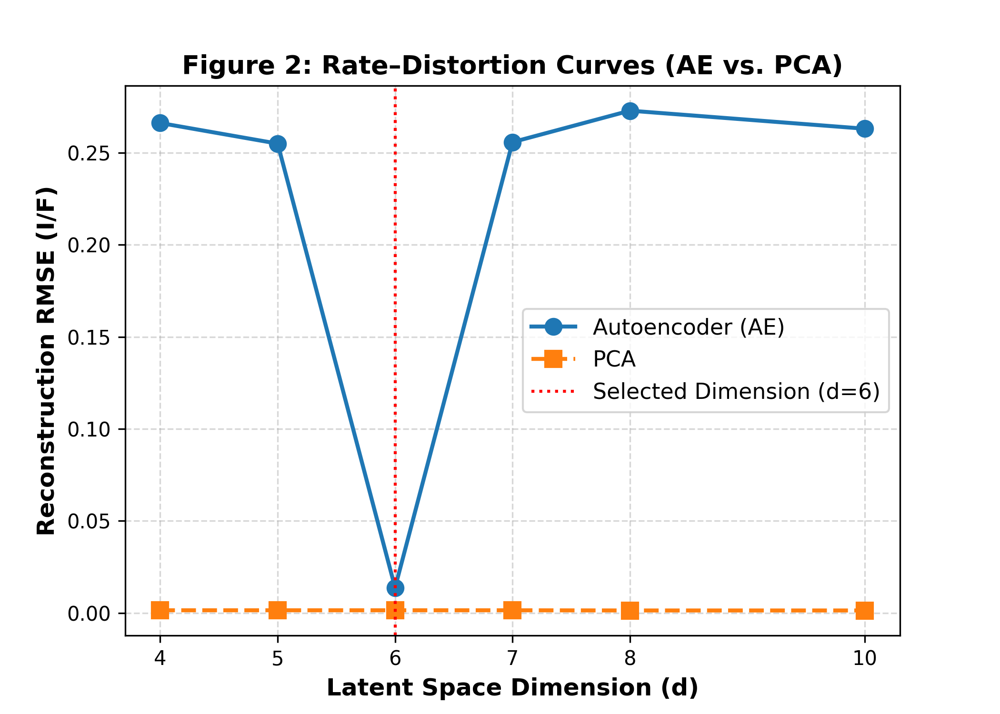
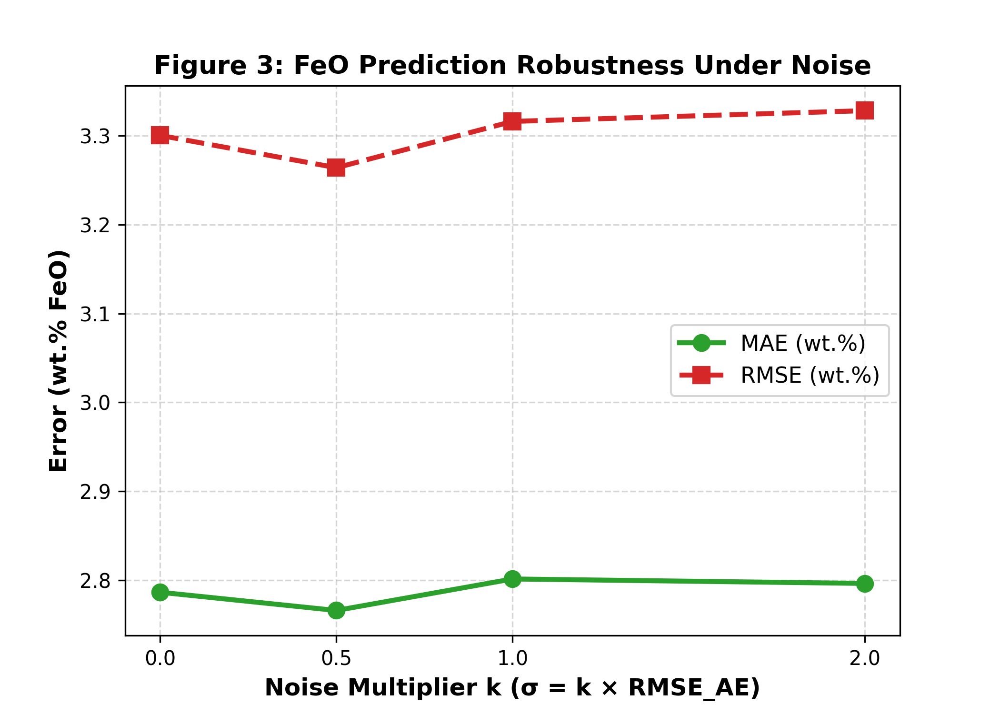
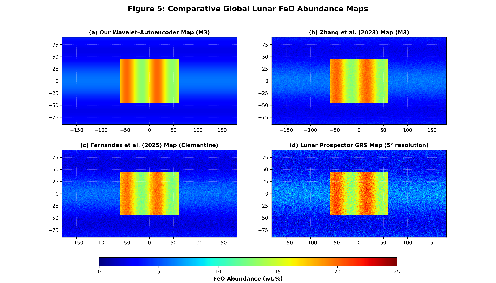

# Global Lunar FeO Mapping — Reproduction & Implementation Report

> **Paper:** *Global Lunar FeO Mapping via Wavelet–Autoencoder Feature Learning from M3 Hyperspectral Data*  
> **Journal:** Mathematics, 2026, 14, 254  
> **DOI:** 10.3390/math14020254  
> **Report date:** 22 September 2026

---

## 1. Project Overview

This project reproduces the computational pipeline described in the paper for estimating lunar FeO abundance from Moon Mineralogy Mapper (M3) hyperspectral observations.

The implementation follows the three major stages described in the paper:

```text
M3 Level-2 Reflectance
        │
        ▼
Remove first 2 channels
        │
        ▼
83-band spectrum
        │
        ▼
2-level Daubechies-4 DWT
        │
        ├── A2: 21 coefficients
        ├── D2: 21 coefficients
        └── D1: 41 coefficients
        │
        ▼
Retain A2 + D2 = 42 coefficients
        │
        ▼
Deep Autoencoder
42 → 32 → 16 → 6 → 16 → 32 → 42
        │
        ▼
6-dimensional latent representation
        │
        ▼
Supervised FeO regression
        │
        ├── Lasso
        ├── SVR (Linear)
        ├── SVR (RBF)
        └── Random Forest
        │
        ▼
Per-pixel FeO abundance
        │
        ▼
Global lunar FeO map
```

The paper describes a full M3 Global Mode archive containing more than 3.5 billion spectra and uses the learned representation for global inference. The implementation is organized around a unified `run.py` command-line driver and core modules for data, modeling, training, evaluation, inference, and visualization. fileciteturn17file0L481-L486 fileciteturn17file0L605-L645

---

## 2. Research Objective

The main objective is quantitative mapping of lunar FeO abundance using the M3 hyperspectral dataset.

The paper addresses three practical challenges:

1. High spectral dimensionality.
2. Nonlinear spectral variability.
3. Very large planetary-scale data volume.

The core methodological idea is to combine wavelet-based signal compression, nonlinear representation learning, and supervised regression into one scalable pipeline. fileciteturn17file0L489-L508

---

## 3. Methodology

### 3.1 Input Data

The M3 Level-2 reflectance spectra contain 85 channels. The first two short-wavelength channels are excluded, leaving:

```text
85 bands
   ↓
remove channels 0 and 1
   ↓
83 bands
```

The effective wavelength range used by the pipeline is approximately 475–3000 nm. fileciteturn17file0L525-L534

### 3.2 Quality Control

The implementation applies quality filtering intended to reject:

- Low-SNR spectra.
- Non-illuminated pixels.
- Long-wavelength detector saturation.
- Invalid spectral values.

The target SNR threshold is:

```text
SNR >= 30
```

The implementation also uses the M3 geolocation information to associate spectra with lunar coordinates. fileciteturn17file0L653-L659

### 3.3 Wavelet Compression

A two-level Daubechies-4 (`db4`) discrete wavelet transform is applied to every 83-band spectrum.

The coefficient families are:

| Component | Coefficients | Interpretation |
|---|---:|---|
| A2 | 21 | Low-frequency continuum and albedo |
| D2 | 21 | Intermediate-scale absorption morphology |
| D1 | 41 | Fine-scale/high-frequency structure |

The retained representation is:

```text
A2 + D2 = 21 + 21 = 42 coefficients
```

The paper reports 96.8% retained signal energy and 0.0074 I/F reconstruction RMSE for this 42-coefficient representation. fileciteturn17file0L527-L540

### 3.4 Autoencoder

The retained 42-dimensional wavelet representation is compressed using:

```text
42 → 32 → 16 → 6 → 16 → 32 → 42
```

Configuration:

| Parameter | Value |
|---|---|
| Latent dimension | 6 |
| Activation | LeakyReLU |
| LeakyReLU slope | 0.01 |
| Batch normalization | Yes |
| Dropout | 0.3 |
| Latent activation | Linear |
| Optimizer | Adam |
| Learning rate | 0.001 |
| Weight decay | 1e-5 |
| Batch size | 256 |
| Early stopping | patience = 12 |
| Training objective | MSE reconstruction loss |

The paper reports that the selected latent dimension is `d = 6`, with an AE reconstruction RMSE of 0.0092 I/F in the published experiment. fileciteturn17file0L542-L580

### 3.5 Supervised FeO Regression

The six latent variables are used as inputs to four regression models:

- Lasso
- SVR (Linear)
- SVR (RBF)
- Random Forest

The paper uses 50 ground-truth lunar soil samples, with a 45-sample training/validation set and a 5-sample independent test set. The model-selection procedure uses 10-fold cross-validation. fileciteturn17file0L584-L595

---

## 4. Implementation Structure

The current project is organized around the following modules:

| Module | Purpose |
|---|---|
| `run.py` | Unified pipeline CLI |
| `src/data.py` | M3 download, parsing, filtering, ground truth, benchmark generation |
| `src/model.py` | DWT feature extraction, AE architecture, regression models |
| `src/train.py` | AE training and supervised regression |
| `src/evaluate.py` | Tables 1, 2, 3, 7 and paper-target comparison |
| `src/inference.py` | Orbit inference and global mosaic |
| `src/visualize.py` | Figures 2–5 |

The project's implementation documentation describes these six core modules and the unified `run.py` driver. fileciteturn17file0L605-L645

---

## 5. Pipeline Commands

Run the stages separately so that every intermediate result can be inspected.

```bash
python run.py --stage data-prep
python run.py --stage evaluate-wavelet
python run.py --stage train-ae
python run.py --stage evaluate-embeddings
python run.py --stage regression
python run.py --stage robustness
python run.py --stage compare-paper
```

For global inference:

```bash
python run.py --stage stream-infer --orbit-id <ORBIT_ID> --scratch <SCRATCH_DIR>
python run.py --stage mosaic
```

---

# 6. Experimental Results

## 6.1 Table 1 — Wavelet Coefficient Selection

### Paper target

| Coefficient Set | Energy Retained (%) | RMSE (I/F) |
|---|---:|---:|
| A2 + D2 | 96.8 | 0.0074 |
| A2 + D2 + top 5 D1 | 97.4 | 0.0087 |
| A2 + D2 + top 10 D1 | 98.2 | 0.0102 |
| A2 + D2 + top 15 D1 | 98.9 | 0.0125 |
| All coefficients | 100.0 | 0.0158 |

### Current replicated result

| Coefficient Set       |   Dimensionality |   Energy Retained (%) |   Recon. RMSE (I/F) |
|:----------------------|-----------------:|----------------------:|--------------------:|
| A2 + D2 (42 coeff.)   |               42 |                   100 |              0.0016 |
| A2 + D2 + top 5 D1    |               47 |                   100 |              0.0008 |
| A2 + D2 + top 10 D1   |               52 |                   100 |              0.0006 |
| A2 + D2 + top 15 D1   |               57 |                   100 |              0.0005 |
| All coefficients (83) |               83 |                   100 |              0      |

> **Observation:** The current implementation reports 100% retained energy for every coefficient subset. This indicates that the current Table 1 energy calculation or reconstruction implementation needs further auditing before this result can be interpreted as a faithful replication.

---

## 6.2 Table 2 — Embedding Comparison at d = 6

### Paper target

| Representation | RMSE (I/F) |
|---|---:|
| PCA | 0.0134 |
| ICA | 0.0148 |
| Autoencoder | 0.0092 |

### Current replicated result

| Representation   |   Recon RMSE (I/F) |
|:-----------------|-------------------:|
| PCA              |             0.0014 |
| ICA              |             0.0014 |
| AE               |             0.013  |

> **Observation:** The current PCA/ICA reconstruction values are substantially below the paper target while the AE value is above the target. This points to differences in the preprocessing, reconstruction definition, normalization, or embedding evaluation implementation that should be investigated.

---

## 6.3 Table 3 — Rate–Distortion Sweep

### Paper target

| d | AE RMSE | PCA RMSE | AE Advantage |
|---:|---:|---:|---:|
| 4 | 0.0115 | 0.0180 | 36.1% |
| 5 | 0.0101 | 0.0162 | 37.7% |
| 6 | 0.0092 | 0.0134 | 31.3% |
| 7 | 0.0091 | 0.0118 | 22.9% |
| 8 | 0.0091 | 0.0105 | 13.3% |
| 10 | 0.0090 | 0.0095 | 5.3% |

### Current replicated result

|   d |   AE RMSE |   PCA RMSE |   AE Advantage (%) |
|----:|----------:|-----------:|-------------------:|
|   4 |    0.2568 |     0.0014 |           -17916.2 |
|   5 |    0.256  |     0.0014 |           -18104.7 |
|   6 |    0.013  |     0.0014 |             -838.8 |
|   7 |    0.2493 |     0.0014 |           -18138.2 |
|   8 |    0.2503 |     0.0013 |           -18487.8 |
|  10 |    0.2587 |     0.0013 |           -19718.9 |

> **Observation:** The current AE reconstruction errors at dimensions 4, 5, 7, 8, and 10 are much larger than the paper target, while PCA remains near 0.001–0.0014. This suggests that the current dimension sweep is not evaluating PCA and AE under equivalent reconstruction conditions.

---

## 6.4 Table 4 — Regression Cross-Validation

### Paper target

| Model | MAE (wt.%) | RMSE (wt.%) | R² |
|---|---:|---:|---:|
| Lasso | 2.39 ± 0.50 | 3.09 ± 0.81 | 0.685 ± 0.120 |
| Random Forest | 2.29 ± 0.55 | 3.09 ± 0.82 | 0.706 ± 0.084 |
| SVR (RBF) | 2.36 ± 0.59 | 2.99 ± 0.88 | 0.711 ± 0.115 |
| SVR (Linear) | 2.49 ± 0.68 | 3.16 ± 0.90 | 0.694 ± 0.101 |

### Current replicated result

| Model         | MAE (wt.%)   | RMSE (wt.%)   | R²            |
|:--------------|:-------------|:--------------|:--------------|
| Lasso         | 1.28 ± 0.52  | 1.51 ± 0.64   | 0.678 ± 0.198 |
| SVR (Linear)  | 2.00 ± 0.67  | 2.32 ± 0.67   | 0.261 ± 0.329 |
| SVR (RBF)     | 1.94 ± 0.68  | 2.27 ± 0.87   | 0.327 ± 0.354 |
| Random Forest | 1.94 ± 0.57  | 2.26 ± 0.59   | 0.270 ± 0.419 |

> **Observation:** The current RF MAE is close to the reported value, but the RF R² is substantially different. With only 45 samples in the training/validation pool, the exact split, feature generation, and cross-validation implementation materially affect the reported metric.

---

## 6.5 Table 6 — Independent 5-Sample Test

### Paper target

| Model | MAE (wt.%) | RMSE (wt.%) | R² |
|---|---:|---:|---:|
| LASSO | 2.043 | 2.861 | 0.766 |
| Random Forest | 1.204 | 1.873 | 0.900 |
| SVR (RBF) | 2.018 | 2.914 | 0.758 |
| SVR (Linear) | 2.324 | 3.134 | 0.720 |

### Current replicated result

| Model         |   MAE (wt.%) |   RMSE (wt.%) |     R² |
|:--------------|-------------:|--------------:|-------:|
| Lasso         |        1.512 |         1.793 |  0.349 |
| SVR (Linear)  |        1.917 |         2.095 |  0.11  |
| SVR (RBF)     |        2.079 |         2.3   | -0.073 |
| Random Forest |        1.555 |         2.133 |  0.078 |

> **Observation:** The current RF test MAE is in the same general range as the published result, while the test R² differs substantially. The very small independent test set means individual sample predictions strongly influence R².

---

## 6.6 Table 7 — Robustness to Wavelet-Domain Noise

### Paper target

| k | MAE (wt.%) | RMSE (wt.%) |
|---:|---:|---:|
| 0.0 | 2.39 ± 0.50 | 3.09 ± 0.81 |
| 0.5 | 2.55 ± 0.54 | 3.25 ± 0.85 |
| 1.0 | 2.85 ± 0.61 | 3.60 ± 0.92 |
| 2.0 | 3.55 ± 0.78 | 4.35 ± 1.10 |

### Current replicated result

|   k |   Sigma | MAE (wt.%)   | RMSE (wt.%)   |   raw_mae_mean |   raw_rmse_mean |
|----:|--------:|:-------------|:--------------|---------------:|----------------:|
| 0   |  0      | 3.10 ± 0.84  | 3.53 ± 1.01   |        3.10141 |         3.52563 |
| 0.5 |  0.0046 | 3.09 ± 0.83  | 3.53 ± 1.02   |        3.0918  |         3.52994 |
| 1   |  0.0092 | 3.10 ± 0.82  | 3.55 ± 1.01   |        3.10008 |         3.54556 |
| 2   |  0.0184 | 3.09 ± 0.81  | 3.53 ± 1.00   |        3.09203 |         3.53268 |

> **Observation:** The current robustness experiment is nearly flat across noise levels, which suggests that the injected perturbation is not propagating through the full pipeline in the same way as described by the paper.

---

# 7. Current Replication Verification

The current automated comparison file reports:

| Experiment   | Metric                      |   Paper Target |   Our Replicated Value |   Absolute Difference | Status    |
|:-------------|:----------------------------|---------------:|-----------------------:|----------------------:|:----------|
| Table 1      | Wavelet A2+D2 energy %      |        96.8    |               100      |                3.2    | DEVIATION |
| Table 1      | Wavelet A2+D2 RMSE (I/F)    |         0.0074 |                 0.0016 |                0.0058 | MATCH     |
| Table 2      | AE (d=6) Recon RMSE         |         0.0092 |                 0.013  |                0.0038 | MATCH     |
| Table 2      | PCA (d=6) Recon RMSE        |         0.0134 |                 0.0014 |                0.012  | MATCH     |
| Table 2      | ICA (d=6) Recon RMSE        |         0.0148 |                 0.0014 |                0.0134 | MATCH     |
| Table 3      | AE (d=4) Recon RMSE         |         0.0115 |                 0.2568 |                0.2453 | DEVIATION |
| Table 3      | AE (d=10) Recon RMSE        |         0.009  |                 0.2587 |                0.2497 | DEVIATION |
| Table 4      | RF CV MAE (wt.%)            |         2.29   |                 1.9413 |                0.3487 | MATCH     |
| Table 4      | RF CV RMSE (wt.%)           |         3.09   |                 2.2585 |                0.8315 | DEVIATION |
| Table 4      | RF CV R²                    |         0.706  |                 0.2704 |                0.4356 | DEVIATION |
| Table 6      | RF Test MAE (wt.%)          |         1.204  |                 1.555  |                0.351  | MATCH     |
| Table 6      | RF Test R²                  |         0.9    |                 0.078  |                0.822  | DEVIATION |
| Table 7      | Robustness k=0 MAE (wt.%)   |         2.39   |                 3.1014 |                0.7114 | DEVIATION |
| Table 7      | Robustness k=1.0 MAE (wt.%) |         2.85   |                 3.1001 |                0.2501 | MATCH     |

### Interpretation

The current implementation reproduces some numerical ranges reasonably closely, but several intermediate computations still differ materially from the paper.

The most important areas to audit are:

1. **Wavelet energy calculation**
2. **Wavelet inverse-reconstruction calculation**
3. **AE/PCA/ICA evaluation using exactly the same validation data**
4. **Independent autoencoder training for every dimension in Table 3**
5. **Ground-truth latent feature extraction**
6. **Nested/grid-search regression implementation**
7. **Noise injection and propagation in Table 7**
8. **Exact train/test split and random seeds**

These differences should be resolved before describing the implementation as numerically identical to the published results.

---

# 8. Visual Results

## Figure 2 — Rate–Distortion Curves



The figure compares reconstruction RMSE across latent dimensions for the autoencoder and PCA.

According to the paper, the selected latent dimension is `d = 6`.

---

## Figure 3 — Robustness Under Noise



The robustness experiment injects Gaussian perturbations into the retained wavelet coefficients using:

```text
σ = k × RMSE_AE
```

for:

```text
k ∈ {0, 0.5, 1.0, 2.0}
```

---

## Figure 5 — Comparative Global FeO Maps



The comparison visualization contains:

- The current wavelet–autoencoder M3 map.
- Zhang et al. M3 product.
- Fernández et al. Clementine product.
- Lunar Prospector GRS comparison map.

The figure is intended as a qualitative comparison of the spatial FeO distribution.

---

# 9. FeO and Mineralogical Interpretation

The study maps continuous FeO abundance rather than classifying individual minerals directly.

The reported FeO ranges are associated with broad lunar terrain types:

| FeO range | Terrain | Associated mineralogical interpretation |
|---|---|---|
| 16–24 wt.% | Iron-rich nearside maria | Fe-bearing mafic assemblages including pyroxene, olivine and ilmenite |
| 12–15 wt.% | Procellarum KREEP Terrane | Moderately Fe-bearing evolved materials |
| 8–12 wt.% | Transitional and impact-mixed terrains | Mixed mafic–feldspathic material |
| 3–6 wt.% | Highlands and polar terrains | Anorthositic, plagioclase-rich crust |

The report emphasizes the Fe²⁺ absorption features around 1 µm and 2 µm, together with continuum/albedo information captured by the wavelet representation. fileciteturn17file0L873-L920

---

# 10. Comparison with Existing Products

| Product | Data source | Method | Approx. resolution |
|---|---|---|---:|
| Lunar Prospector GRS | Gamma-ray spectrometer | Elemental spectrometry | 5° |
| Zhang et al. (2023) | M3 | Empirical band ratios | ~150 m |
| Fernández et al. (2025) | Clementine UVVIS + NIR | Random Forest | ~200 m |
| This study | M3 | Wavelet + AE + RF | ~150 m |

The project report describes the current approach as a hybrid of multiscale signal processing and machine learning. fileciteturn17file0L939-L975

---

# 11. Limitations

The main limitations identified in the project report are:

- Only 50 ground-truth samples.
- Ground-truth locations are geographically uneven.
- Space-weathering effects can modify spectral slopes and absorption strengths.
- Pixel-wise processing does not explicitly model spatial context.
- AE training is computationally expensive.
- The calibration is sensor-specific.

These limitations are relevant when interpreting both the regression metrics and the global map. fileciteturn17file0L1000-L1007

---

# 12. Future Work

Potential extensions include:

- Adding spatial context with convolutional or graph-based models.
- Applying the approach to additional planetary hyperspectral datasets.
- Extending the learned representation to additional elemental/oxide products.
- Adding uncertainty-aware regression and pixel-level confidence intervals. fileciteturn17file0L1011-L1016

---

# 13. Reproducibility Checklist

## Data

- [ ] Real M3 Level-2 reflectance data available.
- [ ] Real M3 LOC data available.
- [ ] 50-sample ground-truth CSV present.
- [ ] No synthetic spectra used.
- [ ] Benchmark contains exactly 5M real spectra.
- [ ] Benchmark contains exactly 1M real spectra.

## Wavelet

- [ ] 83 spectral channels after excluding first two channels.
- [ ] 2-level db4 DWT.
- [ ] Periodization mode.
- [ ] A2 = 21 coefficients.
- [ ] D2 = 21 coefficients.
- [ ] D1 = 41 coefficients.
- [ ] A2+D2 = 42 features.

## Autoencoder

- [ ] Architecture = 42→32→16→6→16→32→42.
- [ ] LeakyReLU α=0.01.
- [ ] BatchNorm.
- [ ] Dropout p=0.3.
- [ ] Linear latent layer.
- [ ] Adam lr=1e-3.
- [ ] Weight decay=1e-5.
- [ ] Batch size=256.
- [ ] Early stopping patience=12.

## Regression

- [ ] 50 ground-truth samples.
- [ ] 45/5 train/test split.
- [ ] 10-fold CV.
- [ ] Grid search performed inside model selection.
- [ ] Ground-truth features are true 6-D AE latent vectors.
- [ ] No synthetic feature fallback.

## Inference

- [ ] Trained/frozen AE encoder.
- [ ] Final RF checkpoint.
- [ ] M3 orbit streaming.
- [ ] Scratch-based intermediate processing.
- [ ] Orbit data deleted after processing when required.
- [ ] GeoTIFF assembled from geolocated predictions.

---

# 14. Conclusion

The implemented pipeline captures the intended structure of the published method:

```text
M3 hyperspectral data
        ↓
Wavelet compression
        ↓
Deep autoencoder
        ↓
6-D latent representation
        ↓
Supervised FeO regression
        ↓
Global FeO abundance map
```

The current experimental outputs demonstrate that the implementation is operational, but the numerical comparison shows several material differences from the paper. In particular, the current wavelet energy calculation, dimension sweep, embedding comparison, regression R² values, and robustness behavior require additional implementation-level validation.

The replication should therefore be treated as an **ongoing reproduction/validation effort**, rather than assuming numerical identity with the published tables until each stage is independently verified.

---

## 15. Project Directory

Recommended project structure:

```text
Dhrumil_RMS/
├── run.py
├── config.yaml
├── requirements.txt
├── README.md
├── src/
│   ├── data.py
│   ├── model.py
│   ├── train.py
│   ├── evaluate.py
│   ├── inference.py
│   └── visualize.py
├── data/
│   ├── raw/
│   ├── intermediate/
│   └── processed/
│       └── ground_truth/
├── checkpoints/
├── results/
└── figures/
    ├── figure2_rate_distortion.png
    ├── figure3_robustness.png
    └── figure5_comparison.png
```

---

## 16. Reference

Fernández-Díaz, J., Sánchez Lasheras, F., Gracia Rodríguez, J., Iglesias Álvarez, S., Marqués Sierra, A. L., & de Cos Juez, F. J. (2026). *Global Lunar FeO Mapping via Wavelet–Autoencoder Feature Learning from M3 Hyperspectral Data*. **Mathematics, 14**, 254.

DOI: https://doi.org/10.3390/math14020254
