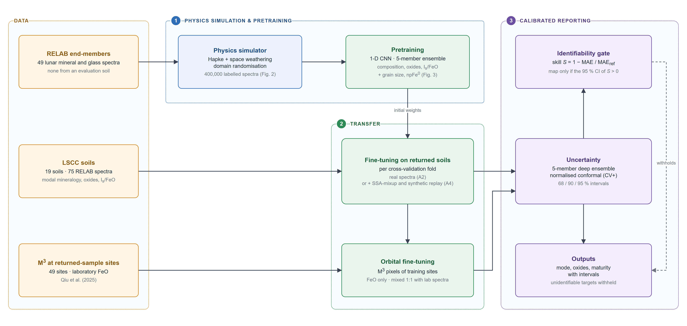
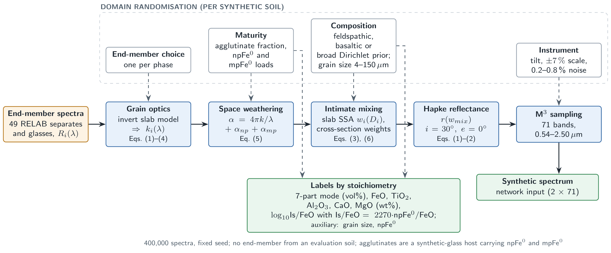
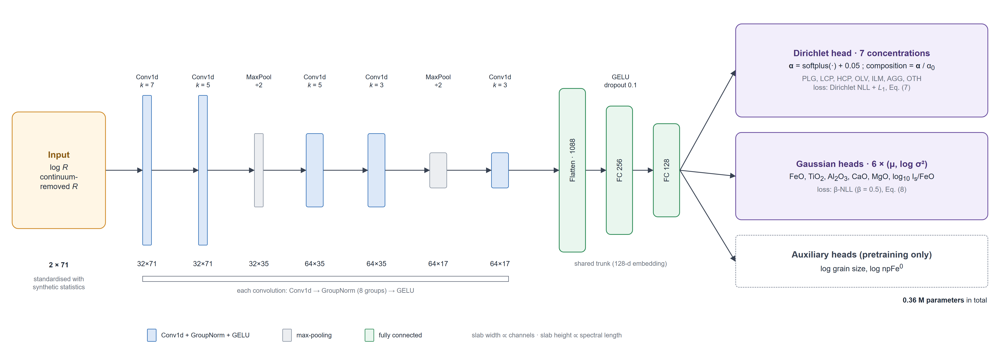
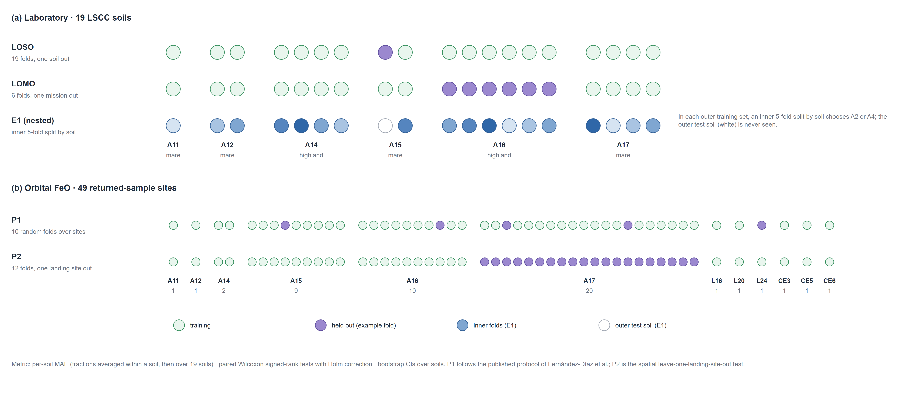
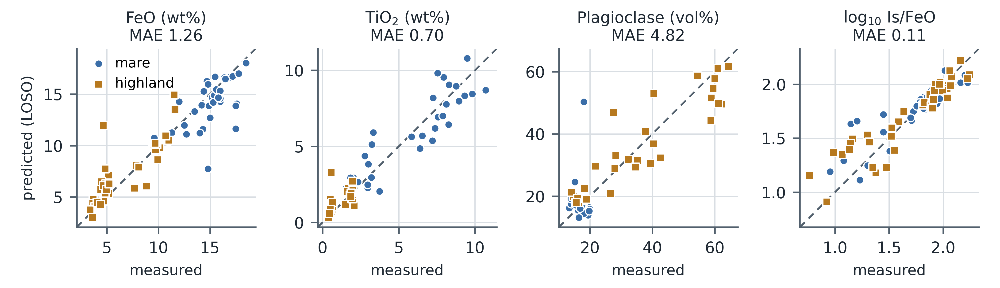
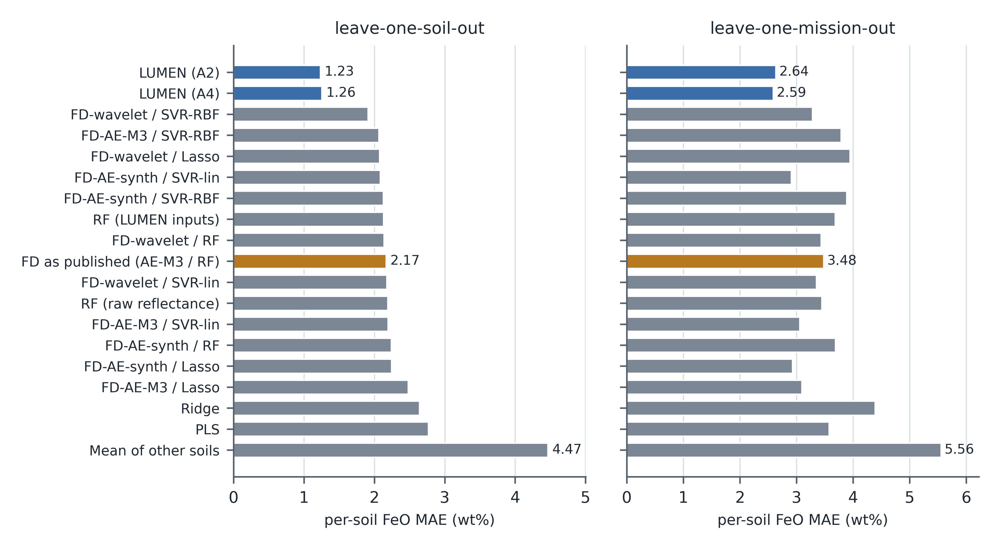

# Physics-Pretrained, Sample-Calibrated Deep Learning for Lunar Soil FeO, Mineralogy and Maturity from Moon Mineralogy Mapper Spectra

## Highlights

**What are the main findings?**

- A one-dimensional network pretrained on 400,000 Hapke-simulated lunar soils and fine-tuned on 19 returned soils predicts FeO, four other oxides, seven-part mineralogy and maturity. On the same laboratory data it reduces FeO error by 42% relative to a published wavelet-autoencoder pipeline and is significantly more accurate than a tuned random forest on 8 of 13 targets
- The ranges between similarities are not very large, and a identifiability gate removes olivine and minor glasses, which no other method could reasonably forecast better than a zero information baseline.

**What are the implications of the main findings?**

- Most of the error in physics only inversions can be eliminated through calibration against returned soils, and not by increasing model complexity.
- Laboratory skill did not transfer to orbit: at 49 returned sample sites, a LUMEN in orbit (3.27 wt% FeO) was not significantly superior to that reported (3.58 wt%) and outperformed by a two-band linear regression (2.11 wt%).

## Abstract

In many cases, lunar soil composition can be recovered from reflectance spectra using empirical regressions, radiative transfer inversions and physics-guided networks. This work presents LUMEN, a one-dimensional convolutional network trained on 400,000 soils from a domain randomised Hapke simulator with nanophase iron space weathering, fine-tuned on laboratory spectra of 19 Lunar Soil Characterization Consortium soils, with conformal prediction intervals and an identifiability gate to with skillful outcomes. Under leave-one-out evaluation with a protocol specified before scoring, LUMEN predicts FeO to 1.26 wt% and TiO₂ to 0.70 wt%, lowers the FeO error of a published wavelet–autoencoder pipeline by 42% and mineral-proportion errors of a Shkuratov-model inversion by 54–74%, and, when configured during cross-validation, is more accurate than a tuned random forest on 8 out of 13 targets. Periodictures reach nominal coverage; olivine is not identifiable. On Moon Mineralogy Mapper spectra of 49 returned sample sites, the laboratory model does not transfer (6.81 wt%), after orbital fine-tuning, it hits 3.27 wt% under leave-one-landing-out and is not any better than the published pipeline (3.58 wt%) or worse than a two-band linear regression (2.11 wt%).

**Keywords:** lunar regolith; FeO; mineral abundance; space weathering; Moon Mineralogy Mapper; Hapke model; deep learning; transfer learning; conformal prediction; uncertainty quantification

## 1. Introduction

Iron and titanium content, modal mineralogy, and space-weathering maturity of the lunar regolith record the crustal and volcanic history of the Moon and constrain its use of resources. The Moon Mineralogy Mapper (M³) on Chandrayaan-1 observed visible to near-infrared reflectance spectra over most of the Moon [1,2]. These spectra show the crystal-field absorptions of Fe²⁺ in pyroxene and olivine near 1 and 2 µm, overprinted with the darkening and reddening of nanophase metallic iron, and their quantification is a trick without solid foundation.

Several mathematical algorithms have been developed to link spectral properties with the composition of samples returned from landing sites. The Clementine band-ratio algorithms of Lucey et al. [3] are the standard for FeO and TiO₂ and the 1 and 2 µm band parameters have been calibrated to M³ [4,5]. These methods range from partial least squares [6], neural networks [7] and support vector machines [8] to comparisons between regressors [9], and convolutional networks on Kaguya Multiband Imager spectra have been used as global maps of oxide when Chang'e-5 [10,11] and Chang'e-6 [12] samples were added; Diviner data [13], gradient boosting [14] and random forests [15] have been used. The method I build on, Fernández-Díaz et al. [16], uses a db4 wavelet decomposition, a deep autoencoder and a random forest regressor to produce a global map of M³ FeO at 150 m per pixel. Each is trained on about 50 sampling sites and evaluated using random splits or small hold-out sets, rarely against other methods or a zero-information baseline.

Physics-based methods model reflectance with radiative transfer. The Hapke model [17] and the results for nanophase iron [18–20] support inversions for mineral abundance, grain size and submicroscopic iron [21–23]; the Shkuratov model [24] has been inverted on M³ by a network trained on synthetic spectra [25]; Hapke inversions have been embedded into Bayesian samplers [26]; and PGU-Net [27] placed a Hapke single-scattering-albedo mixing layer within a deep autoencoder for unsupervised unmixing that validated only on M³ against Kaguya products with sample-informed priors as the next step. Such inversions are interpretable but not unique and sensitive to the end-member set and optical constants. Laboratory studies of the Lunar Soil Characterization Consortium (LSCC) soils have also combined spectra and measured mineralogy [28–30].

We also reproduce three previous methods ([16,25,26]), and find several limitations. For example, the network of Korokhin et al. recovers orthopyroxene, olivine and the grey absorber on its own synthetic test set with only R² of 0.06, 0.17 and 0.32, yet these are mapped; in Jung et al., abundances from the prior alone already meet two of the three published accuracy bounds; and in Fernández-Díaz et al., a random forest on the raw wavelet coefficients is more accurate than one on the autoencoder codes. Each point indicates how much of a returned number is estimated and how it is tested, not the physical models themselves. What we are missing is a method that uses physics as a source of training data, lets returned soils correct it, states its uncertainty and what it cannot identify, and then compare it against the published pipelines with identical data, under grouped cross-validation and against a zero-information baseline.

We propose LUMEN (LUnar Mineralogy Estimation Network) to fill this gap. The main contributions are:

(1) **A hybrid physics-learning method** A domain-randomised Hapke simulator, composed of 49 lunar mineral and glass end-members (none from an evaluation soil) with physically modelled nanophase- and microphase-iron weathering, generates 400,000 synthetic soils. A small, one-dimensional convolutional network is trained on these and fine-tuned on returned soils, and from one spectrum predicts seven-part modal mineralogy, five oxides and maturity. A deep ensemble with conformal calibration supplies intervals with verified coverage, and a gate restricts any target with apparent skill over a zero information baseline.

(2) **An identical-data, protocol-fixed comparison.** LUMEN is compared with wavelet–autoencoder regression [16], Shkuratov-model inversion [25], Hapke–Bayesian inversion [26] and classical regressors using the same 75 laboratory spectra and leave-one-soil-out and leave-one-mission-out folds. Pair tests were used to correct for multiple comparisons. Every evaluation choice was merged into version control before the first score was computed; negative results and null are reported as positive.

(3) **Test of laboratory-to-orbit transfer** Using M³ spectra from returned sample sites on which the base method was calibrated [16,31], as well as its own cross-validation and an honest spatial leave-one-landing-site-out protocol, we show that without orbital labels, a small orbital fine-tuning set recovers, and simple two-band regressions remain better in orbit.

Section 2 describes the data, the physical preliminaries and the method; Section 3 reports the experiments; Section 4 discusses them, including limitations; and Section 5 concludes.

## 2. Materials and Methods

### 2.1. Data and Preprocessing

#### 2.1.1. Laboratory Spectra and Ground Truth

We used the LSCC suite of data [32,33] for nine mare soils (Apollo 11, 12, 15 and 17) and ten highland soils (Apollo 14 and 16) analyzed as <10, 10–20, 20–45 and <45 µm fractions measured at 30° incidence and 0° emission. The 10–20 µm spectrum of soil 70181 was not analyzed, leaving 75 spectra. Point-count modal mineralogy (vol%) data for the three finer fractions (56 spectra) was arranged into seven parts: plagioclase (PLG), low-Ca pyroxene (LCP, orthopyroxene plus pigeonite), high-Ca pyroxene (HCP), olivine (OLV), ilmenite (ILM), agglutinitic glass (AGG) and other phases (OTH). Bulk FeO, TiO₂, Al₂O₃, CaO and MgO (wt%) and maturity index Is/FeO are available for all 75 spectra, but have been checked against their column sum and totals. Each spectra is contigated in the 71 M³ global mode band (540.8–2497.1 nm) with Gaussian responses that span the band width of each channel, except for channels smaller than 2.5 µm.

#### 2.1.2. End-Member Library

The simulator contains 49 RELAB spectra of lunar mineral separates and glasses (17 plagioclase, 7 low-Ca and 11 high-Ca pyroxene, 6 olivine, 4 ilmenite, 2 volcanic and 2 synthetic glasses) from mare basalts, highland rocks, one non-LSCC soil (62241) and synthetic glasses. Each spectra has been individually verified against the PDS4 metadata. No end-members are found in any of the 19 evaluation soils; as each RELAB agglutinate separate is derived from an LSCC soil, we model agglutinates physically (Section 2.3.1).

#### 2.1.3. M³ Data

All orbital data are M³ Level-2 global-mode reflectance [2]. We map the strip in the Shapley-region M3G20090728T214215 as analyzed by Korokhin et al. [25], the strip around the landing site of Apollo 16 (M3G20090607T110414) and the two regions of Aristarchus of interest of Jung et al. [26].

The FeO ground truth in the base method [16] is derived from Qiu et al. [34], which is open access as Supplementary Table 1 of Qiu et al. [31]: 49 stations (Apollo 11–17 landing sites and traverse stations, Luna 16, 20 and 24, and Chang’e-3, -5 and -6) with laboratory FeO and Clementine reflectances at 415–1000 nm, which we confirmed against the worked example in [16] (Apollo 17 LRV-12, 17.4 wt% FeO). For each site, every M³ strip whose nearest pixel lies within 0.01° of the site, at least five samples from the swath edge, contributes its 3 × 3-pixel block if at least 5 of the 9 pixels are valid (finite, 0 < R < 1 on M³ bands 3–85, the band set of [16]); the site spectrum is the per-band median over contributing strips. All 49 sites are covered, Chang'e-5 included, by 183 strips (one to six per site, median four). All input files are recorded in a SHA-256 manifest that is validated at the beginning and end of each processing stage.

### 2.2. Preliminaries: Hapke Model, Single-Scattering Albedo and Space Weathering

To investigate an intimate particle mixture we used the Hapke bidirectional reflectance [17];

$$ r(w) = \frac{w}{4(\mu_0+\mu)}\,H(w,\mu_0)\,H(w,\mu), \tag{1} $$

where $w$ is the single scattering albedo (SSA), $\mu_0$ and $\mu$ are the cosines of the incidence and emission angles (30° and 0° for RELAB). Ignoring the opposition effect and using an isotropic phase function is appropriate for RELAB geometry. $H$ is the approximate Chandrasekhar function

$$ H(w,x) = \left[1 - w\,x\left(r_0 + \frac{1-2r_0x}{2}\ln\frac{1+x}{x}\right)\right]^{-1},\qquad r_0=\frac{1-\gamma}{1+\gamma},\ \gamma=\sqrt{1-w}. \tag{2} $$

Equation (1) is monotonic in $w$ and is inverted numerically from a dense table.

The SSA of a grain population with absorption coefficient $\alpha$, real index $n$, imaginary index $k$ and size $D$ follows the equivalent-slab model [17],

$$ w = S_e + (1-S_e)\,\frac{(1-S_i)\,\Theta}{1-S_i\,\Theta},\qquad \Theta = e^{-\alpha\langle D\rangle}, \tag{3} $$

with

$$ S_e = \frac{(n-1)^2+k^2}{(n+1)^2+k^2} + 0.05,\qquad S_i = 1.014 - \frac{4}{n(n+1)^2},\qquad \langle D\rangle = \frac{2}{3}\left[n^2-\frac{1}{n}(n^2-1)^{3/2}\right]D, \tag{4} $$

If we take $\alpha = 4\pi k/\lambda$ for the case of a pure phase, we use Equations (1)–(4) to solve for $k(\lambda)$ using the nominal grain size for each end-member. This inversion is limited because there is no monotonic relationship between the reflectance and $k$ – it decreases from the beginning until reaching the opacity floor and starts increasing due to surface reflections.

Nanophase metallic iron (npFe⁰) at volume fraction $\phi$ in a host of refractive index $n_h$ adds an absorption [18,19]

$$ \alpha_{np}(\lambda) = \frac{36\pi\, z(\lambda)\,\phi}{\lambda},\qquad z = \frac{n_h^3\, n_{Fe}\, k_{Fe}}{\left(n_{Fe}^2-k_{Fe}^2+2n_h^2\right)^2+\left(2n_{Fe}k_{Fe}\right)^2}, \tag{5} $$

where $n_{Fe}$ and $k_{Fe}$ are the optical constants of iron. Microphase iron (mpFe⁰) is a grey absorber, $\alpha_{mp} = 3\phi_{mp}/(4 r_{mp})$ with $r_{mp} = 0.1$ µm, which darkens without reddening [19]. Components with volume fractions $f_i$, grain sizes $D_i$ and SSAs $w_i$ mix in SSA with cross-section weights,

$$ w_{mix} = \frac{\sum_i (f_i/D_i)\,w_i}{\sum_i f_i/D_i}, \tag{6} $$

and the mixed SSA is converted to reflectance with Equation (1).

### 2.3. Proposed Method: LUMEN

The stages of LUMEN are four (see Figure 1): the physics simulator produces labeled synthetic soils; the neural network is pretrained on these data; and the neural network is then finetuned on returned soils and, in the case of orbit, M³ spectra; while the uncertainty/identifiability layer decides on the output.

**Figure 1.** Introduction to LUMEN. The soil synthetic generated through the physics simulator (see Figure 2) acts as a pre-training step for the network (see Figure 3). It is then fine-tuned with lab spectra from returned soils as well as M³ spectra from returned-sample sites. The identifiability gate decides the targets that are mapped onto.

#### 2.3.1. Domain-Randomised Physics Simulator

A synthetic soil defines its petrology regime, which may be feldspathic, basaltic, or general (Dirichlet priors for crystal fractions bounded by ≤20% of ilmenite and ≤60% of olivine) and a maturity degree which determines the fraction of agglutinates, AGG = clip(0.65 · maturity + N(0, 0.12), 0, 0.75). This is complemented with the load values of npFe⁰ and mpFe⁰, a "residual" fraction, grain size distributed between 4 and 150 µm, as well as one end-member for each phase (Figure 2). Agglutinates include feldspathic-mafic synthetic glass matrix containing the iron loadings, with calibration offset (tilt), ±7% scale, and 0.2 – 0.8% additive noise (instrument noise). Chemical nomenclatures are based on stoichiometries with an accuracy uncertainty (±15%) and molar Fe-Mg isomorphisms used in the nominal phase chemistries. The maturity goal is defined by Is/FeO = 2270 · npFe⁰ (wt %)/FeO (wt %) - a scale-only constant calibrated with fine tuning. Four hundred thousand spectra are created with the same seed value.

**Figure 2.** The physics simulation in the domain-randomization process. The imaginary indices k(λ) of the end-members are derived through the inversion of the equivalent slab; the effects of space weathering include npFe⁰ and mpFe⁰ absorption; the combination of the components occurs through the single-scattering albedo through cross-section weighing; then through the Hapke model they are converted to reflectance; the spectrum gets resampled to 71 M³ bands.

#### 2.3.2. Network

The network (see Figures 3 and Table 1) uses two channels: log reflectance and convex hull continuum-removed reflectance for 71 bands, where standardization takes place according to statistics that is estimated based solely on the artificial dataset. This design includes five 1D convolutional layers, followed by group normalization (a better choice than batch normalization since fine-tuning is based on very small mini-batches) and activation GELU, then two max-pooling. This results in a trunk with dimensions 256 – 128 and 0.36 million parameters. Then a Dirichlet head generates concentrations $\boldsymbol\alpha = \mathrm{softplus}(\cdot)+0.05$, where its mean $\boldsymbol\alpha/\alpha_0$, with $\alpha_0=\sum_j\alpha_j$, is equivalent to seven-part composition. There are heteroscedastic Gaussian heads generating means and logs of variance for oxides and log₁₀(Is/FeO). Auxiliary heads for grain size and npFe⁰ are used during pre-training only.

**Figure 3.** Network architecture. The shape of tensors is defined as channels × bands. Every convolution is followed by group normalization (8 groups) and GELU non-linearity. The auxiliary heads are used only in pre-training.

#### 2.3.3. Objective Functions

The compositional loss is equivalent to the negative log-likelihood of the smoothed labels with respect to the Dirichlet distribution where $\tilde{\mathbf y} = (\mathbf y + \epsilon)/(1 + 7\epsilon)$ and $\epsilon = 0.005$, augmented by $L_1$ regularizer on the mean:

$$ \mathcal L_{comp} = -\frac{1}{7}\left[\ln\Gamma(\alpha_0) - \sum_j \ln\Gamma(\alpha_j) + \sum_j(\alpha_j-1)\ln\tilde y_j\right] + \lambda_1\,\frac{1}{7}\sum_j\left|\frac{\alpha_j}{\alpha_0} - y_j\right|, \tag{7} $$

using $\lambda_1 = 10$ with synthetic data only. Scalar output variables use β-log likelihood [35] for $\beta=0.5$ to reduce the problem of underfitting of high variance data due to Gaussian likelihood.

$$ \mathcal L_{scal} = \frac{\sum_t m_t\,\mathrm{sg}\!\left[\sigma_t^{2\beta}\right]\tfrac12\left(\ln\sigma_t^2 + \frac{(y_t-\mu_t)^2}{\sigma_t^2}\right)}{\sum_t m_t}, \tag{8} $$

In places where the gradient is blocked by $\mathrm{sg}$, and $m_t$ prevents those targets from being used which are not available for that particular sample (mineral composition of the <45 µm size; all targets excluding FeO for orbital spectra). The total loss includes $\mathcal L_{comp}$ and $\mathcal L_{scal}$ along with β-NLL auxiliary terms during pretraining.

#### 2.3.4. Training

The five models comprising the ensemble were pretrained on the synthetic set with different random seed values (15 epochs, AdamW optimizer, one-cycle learning rate schedule, 20,000 spectra for validation), followed by fine-tuning for 1,500 steps per cross-validation split (cf. Table 1). For the complex setup (A4), each training step uses 16 spectra from real training samples, 16 synthetic replay spectra, and 32 spectra from mixup in SSA space, each being a combination of 2–3 training samples as defined by equation (6), precisely labeled (composition – volume fraction, chemistry – mass fractions of Is, FeO, with Is/FeO – by mass × FeO). Real and mixed spectra are passed through calibration and noise randomization in the simulator. The simple setup (A2) consists of just real training samples. The hyperparameter values for both setups were fixed based on the experiments on the synthetic data only.

#### 2.3.5. Uncertainty and Identifiability

The definition of an ensemble mean is the average of the means of all members, whereas that of an ensemble variance is the average of all member variances, plus the variance of the means of the member [36]. Raw ensemble prediction intervals are over-confident (Section 3.5) and hence conformally calibrated [37] using the normalized score, $s_i = |y_i - \mu_i|/\sigma_i$, that uses out-of-fold predictions of other soils to calculate the $\lceil (1-a)(n+1)\rceil$-th smallest value $q_{1-a}$, giving rise to the interval, $\mu \pm q_{1-a}\,\sigma$. The CV+ version uses models where not only the calibration soil but also the test soil was left out (930 more fine-tunes). Identifiability gates are used to determine the skill for every target.

$$ S = 1 - \frac{\mathrm{MAE}}{\mathrm{MAE}_{ref}}, \tag{9} $$

In this case, $\mathrm{MAE}_{ref}$ represents the error of the fraction-matched mean of the other soils used as zero information, with 95% bootstrap confidence interval estimated across soils. Only those targets for which the lower end of the confidence interval is above zero are considered to be mapped.

#### 2.3.6. Transfer to M³

Laboratory and M³ reflectance differ in absolute scale. In zero-shot tasks, M³ spectral data is scaled to the laboratory scale based on the linear scaling algorithm suggested by Korokhin et al. [25].

$$ A_{lab} = 1.685\,A_{M^3} + 0.0355, \tag{10} $$

An outline of the site of mission X of the Apollo program is created with the help of the trained ensemble without mission X soils (in the case of the Luna and Chang'e sites, the ensemble is trained with all 19 soils). During the orbital fine-tuning procedure (LUMEN-M3-FT), the neural network receives an additional training of 600 steps (using AdamW optimizer, 10⁻⁴ learning rate and weight decay, cosine decay) with the batches of 16 M³ pixel spectra of the training sites labeled with the FeO content of the site while all the other targets are masked, as well as 16 laboratory spectra of the training soils with all targets.

## 3. Results

### 3.1. Experimental Setup

#### 3.1.1. Comparison Algorithms

In the spectra in the lab, all the methods use identical spectra and folds. Classical baselines are implemented using the fraction-matched average of the training soils (zero information baseline); partial least squares (PLS), ridge regression, and random forest (RF) run on LUMEN’s 142 inputs; RF on raw reflectance, all of which were optimized with inner grouped cross-validation. The Fernández-Díaz et al. pipeline [16] was completely reimplemented on the identical spectra (db4 A2 + D2 wavelets coefficients; 42 → 32 → 16 → 6 → 16 → 32 → 42 autoencoder trained on M³ pixels as described in the paper or on our synthetic spectra; Lasso, linear SVR, RBF SVR, and RF with search grids from the paper; and no autoencoder version), producing 12 variants, among which "FD as published" is the one that uses M³-trained autoencoder with RF. Outputs of Korokhin et al. [25] and Jung et al. [26] are derived from independent replications verified against the numbers reported in the respective paper (46 of 65 and 32 of 34 gated targets, respectively).

For the M³ dataset (section 3.6), we consider the comparison between LUMEN zero-shot, zero-shot LUMEN plus a linear calibration of $y = a + b\hat y$ based on the training sites, LUMEN-M3-FT, and LUMEN-M3-ridge using the 128-dimensional trunk embedding (referred to as "LUMEN-embed + ridge"), the Fernández-Díaz variations with a re-trained model on M³ site spectra, a linear model using two M³ bands (R950/R750 and R750), Lucey's θ parameter [3] trained on M³, Lucey et al.'s published constants with a re-trained two-band model on Clementine reflectances in the table, and the training fold mean.

#### 3.1.2. Parameter Settings

Table 1 contains the fixed parameters. All LUMEN hyperparameters were tuned using only the synthetic data development, and the evaluation method was fixed before applying the models to any real folds, and the following experiments (Sections 3.3, 3.6, and 3.7) were committed before performing them.

**Table 1.** Fixed LUMEN settings.

| Component | Setting |
|---|---|
| Simulator | 400,000 spectra; 49 end-members; grain size 4–150 µm; scale ±7%; noise 0.2–0.8% |
| Input | 2 × 71 (log R, continuum-removed R), standardised with synthetic statistics |
| Network | 5 conv layers (32/32/64/64/64; kernels 7/5/5/3/3), GroupNorm, GELU, 2 max-pools, trunk 256→128; 0.36 M parameters |
| Losses | Dirichlet NLL + L1 (λ₁ = 10, ε = 0.005); β-NLL (β = 0.5) |
| Pretraining | 5 members, 15 epochs, AdamW, one-cycle, batch 512 |
| Fine-tuning | 1500 steps, AdamW lr 3 × 10⁻⁴, wd 10⁻⁴, warm-up 100, cosine; batch 16 real + 32 SSA-mixup + 16 replay (A4) |
| Orbital fine-tuning | 600 steps, lr 10⁻⁴, batch 16 M³ + 16 lab spectra |
| Uncertainty | 5-member ensemble; normalised conformal (CV+) intervals; gate on bootstrap skill CI |
| Hardware | CPU only (4 cores); pretraining ≈ 45 min; one fine-tune ≈ 6 s |

#### 3.1.3. Evaluation Protocols and Metrics

Figure 4 shows the experimental design. Using leave-one-soil-out (LOSO; 19 folds) strategy, all four fractions of the held-out soil are left out of fine-tuning, mixup, and normalization calculations. Leave-one-mission-out (LOMO; 6 folds: A11, A12, A14, A15, A16, A17) is used as an out-of-distribution test – leaving A16 out removes all feldspathic soils, while leaving A17 out removes all high-Ti soils. The main measure is the mean absolute error (MAE) per soil: the averages of the fractions within each soil are taken, followed by averaging over the 19 soils, such that the number of independent units equals the number of soils rather than the number of spectra. R² and RMSE are calculated per spectrum. Comparisons of methods are made using paired Wilcoxon signed-rank tests per soil [38], with Holm corrections [39] per 13 target minerals or per comparators, and confidence intervals are bootstrapped over soils.

**Figure 4.** Evaluation design. The laboratory predictors are validated through leave-one-soil-out and leave-one-mission-out cross-validation, where the A2/A4 predictor is chosen through inner grouped five-fold cross-validation for each outer training set. The orbital FeO predictor is validated on the 49 sample-return sites through ten-fold cross-validation on the sites (P1, following [16]'s procedure) and leave-one-landing-site-out cross-validation (P2).

### 3.2. Simulator Validation

All simulator's self-tests are passed. The k(λ) of each end-member reproduces its measured reflectance to 7.8 × 10⁻¹¹. Truncating the composition prior reduces the 99th percentile synthetic TiO₂ from 30.5 to 14.0 wt% (LSCC maximum 10.7) and FeO from 31.8 to 24.4 wt%. The LSCC bulk oxides are reproduced by modal composition × class-average phase chemistry with r = 0.93–0.98. Mare TiO₂ is biased by +2.9 wt% which only affects the scale of the pretraining labels. Mixing of their sieve fractions reproduces the measured <45 µm spectra to 0.6% RMS. The median nearest synthetic neighbor distance of the 75 LSCC spectra is 0.102, compared to 0.144 between synthetic spectra, indicating that real data lie inside the synthetic distribution; yet a classifier separates real from synthetic spectra with an AUC of 0.97 (0.99 against noise-free synthetics), with real soils being redder than their nearest synthetic neighbors. Fine tuning must close this sim-to-real gap.

### 3.3. Accuracy on the LSCC Soils

Table 2 shows per-soil MAE values. Under LOSO, LUMEN (A4) has a skill of 0.50 over the zero-information reference for composition and 0.72 for FeO. It has a lower error than all classical baselines on 12 of 13 targets, the exception always being olivine, and after Holm correction it is significantly better than PLS on 9 targets and than the mean of other soils on 10. A4 is lower than the strongest baseline, a random forest on the same inputs, for 12 out of 13 targets, but only maturity is significant after correction (for FeO, raw p = 0.005, Holm p = 0.064). Under LOMO all methods degrade, with A4’s composition MAE increasing from 2.66 to 4.70 vol% and its FeO MAE from 1.26 to 2.59 wt%. A4 is below RF for 10 of the 13 targets, significantly so for LCP, HCP and TiO₂. The zero-information reference is not beaten by any method of “other” class.

**Table 2.** Per-soil MAE, LOSO / LOMO (composition in vol%, oxides in wt%, maturity in log₁₀ Is/FeO). Bold: lowest per row and protocol.

| Target | Mean of others | PLS | Ridge | RF | LUMEN (A4) |
|---|---|---|---|---|---|
| PLG | 14.09 / 17.74 | 11.13 / 16.66 | 10.58 / 16.68 | 7.13 / 12.45 | **4.82 / 11.31** |
| LCP | 3.23 / 3.89 | 2.40 / 3.69 | 2.38 / 3.47 | 2.23 / 3.33 | **1.75 / 2.50** |
| HCP | 2.89 / 3.49 | 1.92 / 1.72 | 1.78 / 1.78 | 1.57 / 1.93 | **1.07 / 1.22** |
| OLV | 0.93 / 1.05 | 0.87 / 1.06 | 0.87 / 1.03 | **0.84 / 0.98** | 0.98 / 1.13 |
| ILM | 2.63 / 3.22 | 1.89 / 2.18 | 1.81 / 2.10 | 1.68 / 2.30 | **1.22 / 1.69** |
| AGG | 9.60 / 9.53 | 9.85 / 12.29 | 9.29 / 11.86 | 7.14 / 9.94 | **5.78 / 9.18** |
| OTH | 3.85 / **4.81** | 3.62 / 5.34 | 3.45 / 5.22 | 3.37 / 5.41 | **3.02** / 5.88 |
| FeO | 4.47 / 5.56 | 2.77 / 3.58 | 2.64 / 4.39 | 2.13 / 3.69 | **1.26 / 2.59** |
| TiO₂ | 2.67 / 3.28 | 1.70 / 2.30 | 1.63 / 1.90 | 1.43 / 2.27 | **0.70 / 1.37** |
| Al₂O₃ | 6.00 / 7.53 | 4.03 / 5.90 | 3.65 / 6.44 | 2.84 / 5.41 | **1.71 / 4.33** |
| CaO | 2.41 / 3.04 | 1.87 / 2.98 | 1.72 / 3.20 | 1.23 / 2.43 | **0.87 / 2.20** |
| MgO | 1.99 / 2.50 | 1.40 / 2.21 | 1.31 / 2.12 | 0.92 / **1.71** | **0.78** / 1.74 |
| log₁₀ Is/FeO | 0.31 / 0.30 | 0.20 / 0.24 | 0.22 / 0.21 | 0.20 / 0.23 | **0.11 / 0.15** |
| Composition (mean) | 5.32 / 6.25 | 4.53 / 6.13 | 4.31 / 6.02 | 3.42 / 5.19 | **2.66 / 4.70** |

As the pre-trained primary model A4 was not optimal (Section 3.7) the A4/A2 model selection was performed using an inner 5-fold stratified cross-validation for each of the outer folds so that the outer estimates remained confirmatory. A2 was chosen in all cases (19/19 and 6/6 for LOSO and LOMO respectively). This model predicted 1.23 wt% FeO, 0.55 wt% TiO₂ and 2.35 vol%. When compared to the RF model, the A2 performs worse than A4 on 12/13 targets but is not olivine. It performs better than the RF on 8 targets when corrected for multiple comparisons using the Holm method. These include PLG, LCP, HCP, ILM, FeO (1.23 vs 2.13 wt%), TiO₂, Al₂O₃ and maturity (Holm p = 0.011). When compared to PLS and ridge regression it performs better on 11/13 targets and performs better than the mean of the other soils on 10/13 targets. The LOMO model performs better than the RF model on 6 targets (LCP, HCP, FeO (2.63 wt%), TiO₂, Al₂O₃ and maturity). No differences were found between the A4 and A2 models using either protocol. The models used here have been re-generated using the pre-trained ensemble members on a different machine. This resulted in all the MAE values for each soil being reproduced within 0.06 for all targets, models and protocols. The predictions made by LOSO protocol for 4 key targets are shown in Figure 5.

**Figure 5.** Prediction of LUMEN (A4) against observed values of 19 LSCC soils for each of FeO, TiO₂, plagioclase and maturity using Leave One Out Cross Validation. Each dot represents a sieve fraction. The line shows a 1:1 relationship.

### 3.4. Comparison with Published Methods

#### 3.4.1. Wavelet–Autoencoder FeO Regression [16]

This is the fairest comparison, since the pipeline was trained using the identical set of spectra and folds (Table 3, Figure 6). For LOSO, LUMEN outperforms FD as published in FeO prediction with 1.26 wt% (R² = 0.85) and is better by 42% compared to FD as published (error = 2.17 wt%, R² = 0.62) and all twelve variants, the best of which was wavelet → RBF SVR without the autoencoder (error = 1.91 wt%). In each paired test, p < 0.05 (the test is fixed in the protocol); with an extra Holm correction across the twelve variants, 3 out of 12 are significant (vs FD as published, Holm p = 0.069). For LOMO, LUMEN gives 2.59 wt% versus 3.48 for FD as published (p = 0.018) and 2.91 wt% for the best variant (p = 0.49). For LOSO, the autoencoder trained on M³ data performs worse for each of four regressors, just like in our reproduction of the original paper (RF 1.55 wt% vs. 1.95 wt% with the autoencoder), while for LOMO, it is beneficial the two linear regressors.

**Table 3.** Values for FeO (wt%) have been provided for similar spectra and folds. "FD-AE-M3" is the tag associated with the published autoencoder model which is trained using M³ pixels, whereas "FD-AE-synth" means that autoencoder is trained using our synthetic spectra. "FD-wavelet" represents a model with no autoencoder. Other variants of FD can be found in tables of the repository.

| Method | MAE LOSO | R² LOSO | MAE LOMO | R² LOMO |
|---|---|---|---|---|
| **LUMEN (A4)** | **1.26** | **0.85** | **2.59** | 0.57 |
| LUMEN (A2, pretrain + real) | 1.23 | 0.86 | 2.64 | 0.58 |
| FD-AE-M3 / RF (published) | 2.17 | 0.62 | 3.48 | 0.25 |
| FD-AE-M3 / Lasso | 2.48 | 0.55 | 3.09 | 0.39 |
| FD-AE-M3 / SVR-lin | 2.19 | 0.65 | 3.06 | 0.41 |
| FD-AE-M3 / SVR-RBF | 2.06 | 0.62 | 3.79 | 0.07 |
| FD-AE-synth / SVR-lin | 2.09 | 0.65 | 2.91 | 0.48 |
| FD-wavelet / SVR-RBF | 1.91 | 0.67 | 3.28 | 0.17 |
| FD-wavelet / Lasso | 2.07 | 0.70 | 3.95 | −0.01 |
| RF (LUMEN inputs) | 2.13 | 0.62 | 3.69 | 0.16 |
| RF (raw reflectance) | 2.19 | 0.58 | 3.45 | 0.27 |
| Mean of other soils | 4.47 | −0.06 | 5.56 | −0.70 |

**Figure 6.** Per-soil FeO error of LUMEN, the Fernández-Díaz et al. variants and the classical baselines on identical folds, under leave-one-soil-out (left) and leave-one-mission-out (right).

#### 3.4.2. Shkuratov-Model Inversion [25]

For each method, there are scores in five minerals (CPX, OPX, OLV, PLG, ILM) in proportions of 100% renormalized among three sieved fractions of soils according to the replication from Korokhin et al. (see Table 4). In the LOSO validation, LUMEN achieves an improvement in scores of the same order –54 to 74 percent for each mineral (all Holm-significant); for example, olivine gets the score 1.91 versus 7.44 and plagioclase – 5.55 versus 12.08. In the LOMO validation, LUMEN again obtains better scores for four of the five minerals, being only significant for olivine, but is slightly inferior for plagioclase with the score 12.64 versus 12.08. The inversion method does not produce LSCC soils at all, but LUMEN is fine-tuned on the rest soils; therefore, the fair comparison would be for LUMEN without training on A0 (only physics): LUMEN has lower scores in three of the five minerals (being significant for olivine). Is/FeO parameter from LUMEN soils has also greater soil ranking than the nFe parameter from the inverted soils in correlation coefficients (ρ) equal 0.72, 0.81, and 0.96 for <10, 10–20, and 20–45 µm fractions respectively against 0.55, 0.37, and 0.44.

**Table 4.** MAE of five-mineral proportions (percentage points), 19 soils.

| Mineral | Mean of others | Korokhin fit | LUMEN A0 (zero-shot) | LUMEN A4 (LOSO) | LUMEN A4 (LOMO) | Holm p, A4 vs fit (LOSO) |
|---|---|---|---|---|---|---|
| CPX | 6.78 | 5.30 | 8.18 | **2.24** | 3.14 | 0.007 |
| OPX | 9.18 | 8.37 | 8.98 | **3.25** | 6.86 | 0.007 |
| OLV | 2.21 | 7.44 | 2.58 | **1.91** | 2.50 | <0.001 |
| PLG | 18.44 | 12.08 | 10.40 | **5.55** | 12.64 | 0.007 |
| ILM | 6.26 | 5.24 | 3.06 | **2.39** | 4.06 | 0.007 |

#### 3.4.3. Hapke–Bayesian Inversion [26]

For the four soils investigated by Jung et al. (samples 12001, 12030, 15071, and 71061; grain size 20–45 µm), arranged in descending order according to the amount of crystalline phases, the LOSS error of LUMEN is 1.00 for olivine, 1.24 for ilmenite, and 7.95 for plagioclase, and thus satisfies all three known accuracy levels (7, 10, and 30 points). On the other hand, the inverted maturity index results in 17.56 points for ilmenite. Considering that only four soils have been examined, this provides lacking evidence: the zero-shot model satisfies all conditions simultaneously, while the average result for other soils does not satisfy the limits of ilmenite and plagioclase. The Is/FeO ratio from LUMEN compares to the measured one at r = 0.99, while the maturity index from the inversion is at approximately r = 0.00.

### 3.5. Uncertainty and Identifiability

Raw ensemble confidence intervals are overconfident (Figure 7): the actual 68/90/95% confidence intervals have means of 0.59/0.82/0.89 when using LOSO and 0.33/0.55/0.64 when using LOMO. Normalised conformal calibration restores the 0.68/0.90/0.95 intervals for LOSO and 0.64/0.86/0.92 for LOMO. Exact CV+, where models were trained without both calibration soil and test soil, produces 0.69/0.90/0.96 (LOSO) and 0.70/0.88/0.93 (LOMO), suggesting that the approximation is somewhat conservative when generalising out-of-distribution. Identifiability gate meets 11 of 13 targets (Table 5). It does not include olivine, which had a LOSO skill of −0.06 (−0.40 to 0.22) and “other” class soil, which had a LOSO skill of 0.22 (−0.03 to 0.42). Agglutinate fraction soil was also excluded due to its lack of significance in LOMO.

**Table 5.** Skill over the zero-information reference with 95% bootstrap CI.

| Target | LOSO skill [CI] | LOMO skill [CI] | Mapped |
|---|---|---|---|
| PLG | 0.66 [0.47, 0.78] | 0.36 [0.19, 0.52] | yes |
| LCP | 0.46 [0.32, 0.59] | 0.36 [0.20, 0.50] | yes |
| HCP | 0.63 [0.53, 0.71] | 0.65 [0.55, 0.74] | yes |
| OLV | −0.06 [−0.40, 0.22] | −0.08 [−0.38, 0.16] | **no** |
| ILM | 0.54 [0.40, 0.64] | 0.47 [0.36, 0.57] | yes |
| AGG | 0.40 [0.16, 0.54] | 0.04 [−0.34, 0.25] | yes |
| OTH | 0.22 [−0.03, 0.42] | −0.22 [−0.51, −0.03] | **no** |
| FeO | 0.72 [0.61, 0.80] | 0.53 [0.44, 0.60] | yes |
| TiO₂ | 0.74 [0.61, 0.82] | 0.58 [0.45, 0.65] | yes |
| Al₂O₃ | 0.71 [0.56, 0.82] | 0.43 [0.28, 0.54] | yes |
| CaO | 0.64 [0.50, 0.75] | 0.28 [0.16, 0.38] | yes |
| MgO | 0.61 [0.37, 0.77] | 0.31 [0.05, 0.47] | yes |
| log₁₀ Is/FeO | 0.63 [0.56, 0.71] | 0.50 [0.32, 0.61] | yes |

**Figure 7.** Empirical against nominal interval coverage for the raw ensemble and after conformal calibration, under leave-one-soil-out and leave-one-mission-out.

### 3.6. FeO from M³ Spectra at Returned-Sample Sites

The base method is assessed for its performance for its assigned task of FeO in orbits employing its ground truth data [16,31], according to two different schemes of tests, P1 and P2 (Figure 4), where P1 represents the internal 10-fold cross validation within each site of the base study, which is consistent with the MAE of 2.29 wt% reported; and P2 represents leave-one-landing site out test in which all sites from one mission is left out because of common terrain and spatial autocorrelation.

**Table 6.** The FeO (wt%) data was taken from 49 returned sample sites using both P1 (10-fold cross-validation with seed 42) and P2 (leave one landing site out) approaches based on spectra of the 3 × 3-pixel site. The bias here means the discrepancy between the predicted FeO and laboratory FeO. All models except the zero-shot model and constants by Lucey et al. were trained for each fold.

| Method | P1 MAE | P1 RMSE | P1 R² | P1 bias | P2 MAE | P2 RMSE | P2 R² | P2 bias |
|---|---|---|---|---|---|---|---|---|
| LUMEN-M3 (zero-shot) | 6.81 | 7.52 | −1.30 | −5.29 | 6.81 | 7.52 | −1.30 | −5.29 |
| LUMEN-M3 + recalibration | 4.39 | 5.17 | −0.09 | −0.04 | 5.11 | 6.34 | −0.63 | 0.17 |
| **LUMEN-M3-FT** | 2.20 | 3.01 | 0.63 | −1.19 | 3.27 | 4.02 | 0.34 | −1.01 |
| LUMEN-embed + ridge | 2.01 | 2.56 | 0.73 | −0.60 | 2.60 | 3.16 | 0.59 | −0.38 |
| FD-AE-M3 / RF (published) | 1.90 | 2.71 | 0.70 | 0.01 | 3.58 | 4.21 | 0.28 | 1.29 |
| FD-AE-M3 / Lasso | 2.11 | 2.71 | 0.70 | 0.01 | 3.07 | 3.78 | 0.42 | 0.78 |
| FD-AE-M3 / SVR-lin | 2.30 | 2.95 | 0.65 | −0.37 | 2.27 | 2.86 | 0.67 | −0.44 |
| FD-AE-M3 / SVR-RBF | 2.12 | 2.85 | 0.67 | −0.02 | 3.27 | 3.86 | 0.40 | 0.56 |
| FD-wavelet / RF | 1.96 | 2.72 | 0.70 | −0.32 | 3.21 | 3.88 | 0.39 | 0.72 |
| FD-wavelet / Lasso | 2.19 | 2.81 | 0.68 | −0.24 | 2.44 | 3.49 | 0.50 | 0.20 |
| FD-wavelet / SVR-lin | 2.49 | 3.16 | 0.59 | −0.61 | 2.54 | 3.41 | 0.53 | −0.02 |
| FD-wavelet / SVR-RBF | 2.40 | 3.39 | 0.53 | −0.03 | 4.39 | 5.94 | −0.44 | 1.31 |
| Two M³ bands (R950/R750, R750) | 1.99 | 2.43 | 0.76 | 0.00 | 2.11 | 2.54 | 0.74 | −0.16 |
| Lucey θ (M³, refitted) | 3.26 | 3.70 | 0.44 | 0.00 | 4.30 | 5.04 | −0.03 | −0.03 |
| Lucey et al. constants (Clementine) ᵃ | 1.25 | 1.72 | 0.88 | −0.17 | 1.25 | 1.72 | 0.88 | −0.17 |
| Two Clementine bands (refitted) | 1.34 | 1.74 | 0.88 | 0.03 | 1.82 | 2.32 | 0.78 | −0.31 |
| Training-fold mean | 4.34 | 5.07 | −0.04 | 0.00 | 4.78 | 5.69 | −0.32 | 0.03 |

ᵃ In-sample. The published constants [3] were derived from returned-sample sites, and nothing is fitted here, so this row is not a held-out estimate and is not comparable with the others.

In the primary assessment (P2), LUMEN-M3-FT shows a smaller MAE than the published FD (3.27 vs 3.58 wt%), but it is more accurate than the latter only at 24 out of 49 locations, and the result does not reach statistical significance (Wilcoxon p = 0.74; Holm p = 1.00 for 13 comparisons). Statistical superiority is shown only against the training-fold mean (Holm p < 0.001), and it is statistically inferior to the two M³ bands (Holm p = 0.009), FD-AE-M3 / SVR-lin (Holm p = 0.029), the two Clementine bands (Holm p = 0.001), and the in-sample Lucey et al. constants (Holm p < 0.001). According to P1, the published FD value (1.90 wt%) correlates well with the reproduced results of the original paper (1.95 wt%) and is lower than its previously reported 2.29 wt% [16]. The LUMEN-M3-FT value (2.20 wt%) significantly differs from no-FD values and the two M³ bands, is significantly less accurate than the two Clementine bands (Holm p = 0.020), and at the same time, is significantly more accurate than the refitted Lucey θ on M³ (Holm p = 0.020).

For the six P1 seeds LUMEN-M3-FT gives an average of 2.13 wt% (2.08 to 2.20) and FD as published is 1.91 wt% (1.81 to 1.97) with FD being lower in every seed and with each strip's centre pixel rather than the 3 × 3 block. LUMEN-M3-FT has 3.26 wt% (vs 3.35 wt% for the published FD, Holm p = 1.00) and is still significantly worse than the two M³ bands (2.02 wt%, Holm p = 0.006). Under P2 the conformal intervals for LUMEN-M3-FT cover 0.63, 0.92 and 0.98 of the sites at the nominal 68, 90 and 95% (raw ensemble 0.51, 0.76 and 0.86) with mean half widths of 4.6 wt% at 68% and 10.6 wt% at 95%.

**Figure 8.** Predicted against lab FeO at 49 returned-sample sites for P2 (leave one landing site out). The plots show the predictions of LUMEN-M3-FT, FD (as published) and the two M³ band linear model. The symbol indicates the landing site. The red line represents 1:1.

### 3.7. Ablations and Parameter Analysis

The pretraining does improve performance, yet the pre-registered primary model is not the optimal configuration (Table 7). Pretrained A2 has a lower error than the same model trained from scratch (A1) on all 13 targets under LOSO, though, due to the correlation of the targets, none of the differences are statistically significant after Holm correction; under LOMO, two are (HCP and maturity). The SSA-mixup and synthetic replay decrease the error of the pretrained model (A4 vs A2) on only one out of 13 targets, without any statistically significant difference, and help a model trained from scratch under LOSO (12 of 13 targets), but not under LOMO (2 of 13). The zero-shot A0, the physics-only equivalent of a simulator-trained inversion, has an MAE of 9.1 vol%.

**Table 7.** Ablations: per-soil MAE, LOSO / LOMO. A4 is the pre-registered primary model.

| Target | A0 zero-shot | A1 scratch, real | A1m scratch + mixup | A2 pretrain + real | A3 pretrain + mixup | A4 full |
|---|---|---|---|---|---|---|
| PLG | 13.99 / 13.99 | 4.84 / 11.76 | 4.21 / 12.01 | 4.17 / 12.01 | 4.25 / 12.31 | 4.82 / 11.31 |
| LCP | 4.88 / 4.88 | 1.58 / 2.45 | 1.57 / 2.57 | 1.42 / 2.12 | 1.41 / 2.15 | 1.75 / 2.50 |
| HCP | 4.51 / 4.51 | 1.21 / 1.72 | 1.19 / 1.82 | 0.85 / 1.09 | 0.94 / 1.15 | 1.07 / 1.22 |
| OLV | 1.22 / 1.22 | 0.91 / 1.02 | 0.92 / 1.04 | 0.86 / 1.03 | 0.93 / 1.06 | 0.98 / 1.13 |
| ILM | 1.83 / 1.83 | 1.30 / 1.95 | 1.30 / 2.07 | 1.08 / 1.70 | 1.22 / 1.90 | 1.22 / 1.69 |
| AGG | 25.53 / 25.53 | 6.19 / 9.61 | 5.68 / 9.34 | 5.42 / 9.64 | 5.50 / 9.45 | 5.78 / 9.18 |
| OTH | 12.00 / 12.00 | 2.78 / 5.63 | 2.70 / 5.82 | 2.69 / 5.82 | 2.77 / 6.06 | 3.02 / 5.88 |
| FeO | 4.57 / 4.57 | 1.46 / 2.75 | 1.32 / 3.00 | 1.23 / 2.64 | 1.23 / 2.71 | 1.26 / 2.59 |
| TiO₂ | 3.91 / 3.91 | 0.82 / 1.43 | 0.76 / 1.57 | 0.56 / 1.08 | 0.66 / 1.36 | 0.70 / 1.37 |
| Al₂O₃ | 3.79 / 3.79 | 1.74 / 4.35 | 1.58 / 4.62 | 1.51 / 4.24 | 1.61 / 4.54 | 1.71 / 4.33 |
| CaO | 1.69 / 1.69 | 0.76 / 2.12 | 0.74 / 2.29 | 0.73 / 2.20 | 0.76 / 2.29 | 0.87 / 2.20 |
| MgO | 1.84 / 1.84 | 0.82 / 1.58 | 0.69 / 1.69 | 0.71 / 1.74 | 0.71 / 1.75 | 0.78 / 1.74 |
| log₁₀ Is/FeO | 0.30 / 0.30 | 0.15 / 0.19 | 0.14 / 0.18 | 0.12 / 0.14 | 0.13 / 0.15 | 0.11 / 0.15 |
| Composition (mean) | 9.14 / 9.14 | 2.69 / 4.88 | 2.51 / 4.95 | 2.36 / 4.77 | 2.43 / 4.87 | 2.66 / 4.70 |

Even without physics, however, the network provides superior performance to classical regression methods in 5 of 13 targets for LOSO (PLG, ILM, FeO, TiO₂, and Al₂O₃) and 3 for LOMO, and in 8 and 6 targets with the pretrained network A2; this is why the network selection is shifted inside the cross-validation procedure (Section 3.3).

There are four design alternatives which were pre-trained and fine-tuned using the A4 recipe, each with two members, relative to members 0–1 of the baseline network (Table 8; FeO 1.32 wt% under LOSO and 2.62 wt% under LOMO). The log reflectance feature on its own already achieves non-significantly different performance compared to the other designs, suggesting that the continuum-removed channel does not add any significant advantage; similarly on other side, the continuum-removed channel on its own achieves significantly lower accuracy on six targets under LOSO and eight targets under LOMO (FeO 2.09 and 3.86 wt%, respectively). The multilayer perceptron (MLP) design is significantly inferior to the LCP design under LOSO, but significantly superior to it on four targets under LOMO (PLG, FeO, Al₂O₃, and CaO; FeO 2.30 wt%).

**Table 8.** Alternative designs compared with the main network (alternative: two members, target: thirteen sites, Holm adjustment performed on targets): "Lower MAE": The number of targets in which the MAE of the variant is lower than the one from the main network per soil. "Better / Worse": The number of targets where a Holm significant difference in favor of or against the variant exists.

| Variant | Parameters | LOSO: lower MAE | LOSO: better / worse | LOMO: lower MAE | LOMO: better / worse |
|---|---|---|---|---|---|
| Main network (log R + continuum-removed, CNN) | 0.36 M | — | — | — | — |
| Log R only | 0.36 M | 10 / 13 | 0 / 0 | 5 / 13 | 0 / 0 |
| Continuum-removed only | 0.36 M | 0 / 13 | 0 / 6 | 1 / 13 | 0 / 8 |
| MLP | 0.07 M | 0 / 13 | 0 / 1 | 9 / 13 | 4 / 0 |
| 1-D ResNet | 0.42 M | 7 / 13 | 0 / 0 | 8 / 13 | 0 / 0 |

### 3.8. Application to M³ Scenes

At the Apollo 16 landing-site pixel, the published calibration (eqn. 10) reproduces the LSCC 62231 spectrum to 9.1% rms and the lines re-derived from this pixel to 1.4%; LUMEN estimates 5.0 wt% FeO here (62231: 4.9 wt%; Apollo 16 mean: 4.6 wt%) and over-estimates TiO₂ (2.1 vs 0.6 wt%), only a sanity check, since 62231 is in the final training set. In the Shapley scene (Figure 9) the 11 identifiable targets show the expected contrasts (FeO 10.2 wt% on mare and 6.6 wt% on highland; Al₂O₃ 20.0 and 24.3 wt%) and fresh craters stand out as immature. The published high-Ca pyroxene map of the same strip [25] is anti-correlated with LUMEN's (r = −0.79), placing more clinopyroxene in the highlands than in the mare, and its maturity parameter is nearly unrelated to LUMEN's Is/FeO (r = −0.28). Destriping lowers stripe amplitude by 26–47% and leaves the maps correlated at r = 0.90–0.99 with the undestriped ones. At Aristarchus, LUMEN detects much less olivine and more plagioclase within the crystalline fraction than the posterior values of Jung et al. [26] (52% vs 29% plagioclase in region B); because the LUMEN olivine fraction does not pass the identifiability gate, this is a domain-shift warning, not a refutation of that paper.

**Figure 9.** LUMEN maps of the Shapley-region M³ strip for identifiable targets, with conformal interval half-widths. Olivine and "other" are withheld by the identifiability gate.

## 4. Discussion

### 4.1. What Carries the Gain on Laboratory Spectra

Most importantly, calibration to real soils. The zero-shot network is the weakest LUMEN model and, composition-wise, below the zero-information reference, while any fine-tuning on returned soils reduces the error by a factor of 2 to 4. This, combined with the simulator analysis, where the LSCC spectra are within the synthetic distribution while still being distinguishable from it, demonstrates that a physics model accurate enough to span the data is not necessarily accurate enough to be inverted.

The rest add in various ways. Total learning through the entire range is a real component in the performance gain since even a network trained from scratch is already better than a tuned random forest. But the convolutional architecture is a good but not an optimal design – the continuum removed channel gives no improvement at all, a one-dimensional ResNet works equally well, and an MLP better generalizes to an unseen target comprising four channels. Physics pretraining is consistently beneficial but its importance is significant only for out-of-distribution tasks, which makes the simulator not a calibrated forward model, but a source for an improved starting representation instead. Neither SSA-space mixup nor replay brought anything after pretraining, whether due to smoothness over the composition space being provided by pretraining, or inability to check the validity of the cross-section mixing weight: the sieve fraction spectra mixes linearly to 0.6% RMS, but the LSCC chemistry does not limit the mass ratios strongly enough. And finally, choosing the configuration within each training fold maintains the considerable performance edge over the random forest, making configuration selection unnecessary.

### 4.2. Comparison with Published Methods

Three comparisons are non-equivalent. Of these, only the Fernández-Díaz et al. [16] pipeline was trained on the same spectra and folds, so the fact that LUMEN's FeO error is 42% less gives us an unbiased comparison, and verifies the information compression of autoencoder stage. Korokhin et al. [25] and Jung et al. [26] never see an LSCC soil, so the LUMEN margins over them are mostly a measure of the value of calibrating by returned soils: the zero-shot LUMEN far exceeds the Shkuratov inversion in only olivine, and Jung et al. four test soils are too few for a strong conclusion. One practically relevant property is maturity, to which physics methods in this comparison ranked worse than the calibrated Is/FeO provided by LUMEN.

### 4.3. Laboratory-to-Orbit Transfer

As for the inherent purpose of the base method, the resulting errors are contradictory to the LUMEN. In cases when whole landing sites (P2) are excluded, most of the fitted models produce greater errors than models based on randomly chosen folds (P1); however, the scale of this difference is significantly different: the maximum decrease is observed in the random forest and RBF-SVR models – it is within the range between 55% and 88%, whereas the FD error rate rises from 1.90 to 3.58 wt%. The LUMEN-M3-FT model has the biggest percentage increase in errors – by 49%, whereas the two-M³-band and linear SVR regression models have the lowest values – the difference is within the range of 6% and from −1% to +2%, respectively. If randomly chosen folds are used, flexible models can use the spectral properties of the adjacent landing site.

LUMEN-M3-FT's predictions are compressed toward the mean (Figure 8), over-estimating the Apollo 16 highland sites by 4.8 wt% on average and under-estimating the FeO-rich Chang'e-3, Chang'e-5 and Luna 24 sites by 6.3–7.5 wt%. With a few dozen training sites per fold, a linear model on two band parameters makes better use of the orbital labels, and even a ridge regression on LUMEN's embedding (2.60 wt%, not tested for significance) does better than fine-tuning the whole network. The laboratory-to-orbit gap is big: zero-shot predictions are suboptimal compared to the training-fold mean, linear recalibration eliminates their bias but not their error, and orbital fine-tuning reduces their error by half without reducing the gap. The calibration itself is uncertain, since the published transfer reproduces the Apollo 16 lab spectrum at 9.1% RMS, whereas a line back-calculated from that pixel is 1.4%.

The in-sample Lucey/Clementine result doesn’t prove that the Lucey algorithm outperforms other methods at a new site—its constants come from sites where samples were already returned. What it does show is that one parameter, θ, carries most of the FeO signal in that context. When we refit the two-band model within each fold, it actually matches the Clementine reflectances on the table better than it matches the M³ site spectra (1.82 vs 2.11 wt% under P2). That suggests some of the orbital error comes from the M³ site spectra themselves—calibration, photometry, or even site localization—rather than from the regressors. Looking at the mapped scenes, the biggest mismatches with published maps pop up exactly where LUMEN’s gate holds back the output (in olivine regions), or where the published network already struggles (with the pyroxene split or with maturity).

### 4.4. Uncertainty and Identifiability

Deep ensembles tend to be over-confident, especially when dealing with out-of-distribution data. Normalized conformal calibration helps fix this, bringing coverage back to near-nominal levels, and you get this benefit without any extra training. This holds even in orbit, where at 95% coverage, the intervals average ±10.6 wt%. So, you get honest intervals—they're accurate, though not always practically useful. The gating method clarifies something that other approaches only hint at: we can’t actually predict olivine abundance in these soils any better than simply taking the mean from other soils. None of the methods we tried did any better. As a result, maps showing olivine and "other" from physics-based inversion methods just mirror their priors and end-member sets if you don’t have independent evidence to back them up. But don't misinterpret this: these soils just happen to contain very little olivine (≤5 vol%). So, this is a specific statement about the LSCC domain. It’s not saying olivine can’t be detected at all—just that it’s rare here. Where olivine is plentiful, detection isn’t an issue.

### 4.5. Limitations

The ground truth set is small: just 19 laboratory soils, 56 spectra with modal mineralogy, and 49 orbital sites (20 from Apollo 17 stations). A number of large numeric gaps vanish after correction. There's a gap between how lab spectra are collected—sieved fractions under fixed geometry—and how M³ pixels see the Moon, integrating rock, regolith, and topography over areas around 140 meters. Orbital comparisons lean on exact coordinates and a single linear calibration. The simulator’s chemistry labels show a positive bias for mare TiO₂, around +2.9 wt%, and its maturity scale pins everything to one constant, which puts constraints on the zero-shot model. Physics baselines come from independent reproductions, and we re-implemented the Fernández-Díaz pipeline based on published descriptions. The orbital fine-tuning method was set beforehand and left unchanged; trying different recipes or smaller networks calls for more orbital ground truth. Testing transfer to other sensors, like Chandrayaan-2 IIRS, isn't part of this work.

## 5. Conclusions

LUMEN is a physics-pretrained, sample-calibrated network that pulls out lunar soil mineralogy, chemistry, and maturity directly from M³-band reflectance. It does this using calibrated intervals and always makes clear which outputs you can actually identify. Tested on the same lab spectra, using the same folds, and under a protocol locked down before any scoring, LUMEN cuts FeO error by 42% compared to a published wavelet–autoencoder pipeline. For mineral-proportion errors, it reduces them by between 54% and 74% when stacked up against an inversion method based on the Shkuratov model. It matches the published accuracy range for Hapke–Bayesian inversion too. When its setup is chosen during cross-validation, it outperforms a tuned random forest on 8 of 13 targets. Nearly all the gains over pure physics-driven methods come from calibrating on real returned soils. Training across the full spectrum and doing physics-based pretraining help as well. The convolutional structure isn’t anything special here—it’s not what drives the improvement. And the proposed SSA-space augmentation turns out not to add value.

At 49 returned-sample sites with M³ spectra, LUMEN does not improve on the published pipeline by zero-shot transfer (no training on a given site), does not improve with orbital fine-tuning, and is significantly worse than a two-band linear regression, so the deep model does not beat simple band regressions for orbital FeO at the returned sites. Olivine and minor glass abundances are not inferrable from these spectra in any of the methods we tried. Further work would increase the orbital ground-truth available, presently the limiting factor, and incorporate independent map-level validation against Kaguya and Clementine FeO maps, and deploy the method on IIRS with explicit sensor model.

---

**Author Contributions:**

**Funding:**

**Data Availability Statement:** You’ll find all the code, the version-controlled evaluation protocol, every intermediate table, and the staged input data—along with their SHA-256 manifests—at https://github.com/DSheth2004/lumen-lunar-dl. The RELAB spectra come from the PDS Geosciences Node spectral library, and the M³ data sit in the NASA Planetary Data System. For the returned-sample FeO table, check Supplementary Table 1 in Qiu et al. [31].

**Acknowledgments:** Thanks to the RELAB facility at Brown University, and the Lunar Soil Characterization Consortium for the laboratory data; to the M³ team and the Planetary Data System for the orbital data.

**Conflicts of Interest:**

**Abbreviations**

| Abbreviation | Meaning |
|---|---|
| AGG | agglutinitic glass |
| CV+ | cross-validation-plus conformal prediction |
| FD | Fernández-Díaz et al. pipeline |
| HCP / LCP | high- / low-Ca pyroxene |
| ILM | ilmenite |
| LOSO / LOMO | leave-one-soil-out / leave-one-mission-out |
| LSCC | Lunar Soil Characterization Consortium |
| M³ | Moon Mineralogy Mapper |
| MAE | mean absolute error |
| npFe⁰ / mpFe⁰ | nanophase / microphase metallic iron |
| OLV | olivine |
| OTH | other phases |
| PLG | plagioclase |
| RELAB | Reflectance Experiment Laboratory |
| RF | random forest |
| SSA | single-scattering albedo |

## References

1. Pieters, C.M.; Boardman, J.; Buratti, B.; Chatterjee, A.; Clark, R.; Glavich, T.; Green, R.; Head, J., III; Isaacson, P.; Malaret, E.; et al. The Moon Mineralogy Mapper (M3) on Chandrayaan-1. *Curr. Sci.* **2009**, *96*, 500–505.
2. Green, R.O.; Pieters, C.; Mouroulis, P.; Eastwood, M.; Boardman, J.; Glavich, T.; Isaacson, P.; Annadurai, M.; Besse, S.; Barr, D.; et al. The Moon Mineralogy Mapper (M3) imaging spectrometer for lunar science: Instrument description, calibration, on-orbit measurements, science data calibration and on-orbit validation. *J. Geophys. Res.* **2011**, *116*, E00G19. https://doi.org/10.1029/2011je003797.
3. Lucey, P.G.; Blewett, D.T.; Jolliff, B.L. Lunar iron and titanium abundance algorithms based on final processing of Clementine ultraviolet‐visible images. *J. Geophys. Res. Planets* **2000**, *105*, 20297–20305. https://doi.org/10.1029/1999je001117.
4. Bhatt, M.; Mall, U.; Bugiolacchi, R.; McKenna-Lawlor, S.; Banaszkiewicz, M.; Nathues, A.; Ullaland, K. Lunar iron abundance determination using the 2-μm absorption band parameters. *Icarus* **2012**, *220*, 51–64. https://doi.org/10.1016/j.icarus.2012.04.010.
5. Bhatt, M.; Mall, U.; Wöhler, C.; Grumpe, A.; Bugiolacchi, R. A comparative study of iron abundance estimation methods: Application to the western nearside of the Moon. *Icarus* **2015**, *248*, 72–88. https://doi.org/10.1016/j.icarus.2014.10.023.
6. Sun, L.; Ling, Z.; Zhang, J.; Li, B.; Chen, J.; Wu, Z.; Liu, J. Lunar iron and optical maturity mapping: Results from partial least squares modeling of Chang'E-1 IIM data. *Icarus* **2016**, *280*, 183–198. https://doi.org/10.1016/j.icarus.2016.07.010.
7. Xia, W.; Wang, X.; Zhao, S.; Jin, H.; Chen, X.; Yang, M.; Wu, X.; Hu, C.; Zhang, Y.; Shi, Y.; et al. New maps of lunar surface chemistry. *Icarus* **2019**, *321*, 200–215. https://doi.org/10.1016/j.icarus.2018.10.031.
8. Wang, X.; Zhang, J.; Ren, H. Lunar surface chemistry observed by the KAGUYA multiband imager. *Planet. Space Sci.* **2021**, *209*, 105360. https://doi.org/10.1016/j.pss.2021.105360.
9. Qiu, D.; Li, F.; Yan, J.; Gao, W.; Chong, Z. Machine learning for inversing FeO and TiO2 content on the Moon: Method and comparison. *Icarus* **2022**, *373*, 114778. https://doi.org/10.1016/j.icarus.2021.114778.
10. Yang, C.; Zhang, X.; Bruzzone, L.; Liu, B.; Liu, D.; Ren, X.; Benediktsson, J.A.; Liang, Y.; Yang, B.; Yin, M.; et al. Comprehensive mapping of lunar surface chemistry by adding Chang'e-5 samples with deep learning. *Nat. Commun.* **2023**, *14*, 7554. https://doi.org/10.1038/s41467-023-43358-0.
11. Zhang, L.; Zhang, X.; Yang, M.; Xiao, X.; Qiu, D.; Yan, J.; Xiao, L.; Huang, J. New maps of major oxides and Mg# of the lunar surface from additional geochemical data of Chang'E-5 samples and KAGUYA multiband imager data. *Icarus* **2023**, *397*, 115505. https://doi.org/10.1016/j.icarus.2023.115505.
12. Shi, X.; Chen, J.; Wang, J.; Liu, S.; Tong, X.; Li, J.; Yan, Z.; Wen, S.; Xie, H.; He, Z.; et al. Refined lunar global chemistry mapping using farside ground truth information gathered by Chang’e-6. *Nat. Sens.* **2026**, *1*, 232–240. https://doi.org/10.1038/s44460-025-00021-z.
13. Ma, M.; Li, B.; Chen, S.; Lu, T.; Lu, P.; Lu, Y.; Jin, Q. Global estimates of lunar surface chemistry derived from LRO diviner data. *Icarus* **2022**, *371*, 114697. https://doi.org/10.1016/j.icarus.2021.114697.
14. Wu, S.; Chen, J.; Xue, C.; Pan, Y.; Zhang, C. Global Inversion of Lunar Surface Oxides by Adding Chang’e-5 Samples. *Remote Sens.* **2024**, *16*, 1812. https://doi.org/10.3390/rs16101812.
15. Fernández-Díaz, J.; de Cos Juez, F.J.; Sánchez Lasheras, F.; Gracia Rodriguez, J. Spectral Parameter-Based Prediction of Lunar FeO Content Using Random Forest Regression. *Mathematics* **2025**, *13*, 2802. https://doi.org/10.3390/math13172802.
16. Fernández-Díaz, J.; Sánchez Lasheras, F.; Rodríguez, J.G.; Álvarez, S.I.; Marqués Sierra, A.L.; de Cos Juez, F.J. Global Lunar FeO Mapping via Wavelet–Autoencoder Feature Learning from M3 Hyperspectral Data. *Mathematics* **2026**, *14*, 254. https://doi.org/10.3390/math14020254.
17. Hapke, B. *Theory of Reflectance and Emittance Spectroscopy*; Cambridge University Press: Cambridge, UK, 1993.
18. Hapke, B. Space weathering from Mercury to the asteroid belt. *J. Geophys. Res. Planets* **2001**, *106*, 10039–10073. https://doi.org/10.1029/2000je001338.
19. Lucey, P.G.; Riner, M.A. The optical effects of small iron particles that darken but do not redden: Evidence of intense space weathering on Mercury. *Icarus* **2011**, *212*, 451–462. https://doi.org/10.1016/j.icarus.2011.01.022.
20. Pieters, C.M.; Noble, S.K. Space weathering on airless bodies. *J. Geophys. Res. Planets* **2016**, *121*, 1865–1884. https://doi.org/10.1002/2016je005128.
21. Li, S.; Li, L. Radiative transfer modeling for quantifying lunar surface minerals, particle size, and submicroscopic metallic Fe. *J. Geophys. Res. Planets* **2011**, *116*, 2011JE003837. https://doi.org/10.1029/2011je003837.
22. Sun, L.; Lucey, P.G. Unmixing Mineral Abundance and Mg# With Radiative Transfer Theory: Modeling and Applications. *J. Geophys. Res. Planets* **2021**, *126*, e2020JE006691. https://doi.org/10.1029/2020je006691.
23. Trang, D.; Lucey, P.G. Improved space weathering maps of the lunar surface through radiative transfer modeling of Kaguya multiband imager data. *Icarus* **2019**, *321*, 307–323. https://doi.org/10.1016/j.icarus.2018.11.014.
24. Shkuratov, Y.; Starukhina, L.; Hoffmann, H.; Arnold, G. A Model of Spectral Albedo of Particulate Surfaces: Implications for Optical Properties of the Moon. *Icarus* **1999**, *137*, 235–246. https://doi.org/10.1006/icar.1998.6035.
25. Korokhin, V.; Surkov, Y.; Mall, U.; Kaydash, V.; Velichko, S.; Velikodsky, Y.; Shalygina, O. Applying machine learning to a nonlinear spectral mixing model for mapping lunar soils composition using CHANDRAYAAN-1 M3 data. *Planet. Space Sci.* **2024**, *244*, 105870. https://doi.org/10.1016/j.pss.2024.105870.
26. Jung, J.I.; Lapôtre, M.G.A.; Milliken, R.E.; Minson, S.E. Remote Compositional Analyses of Space-weathered Lunar Maria. *Planet. Sci. J.* **2026**, *7*, 18. https://doi.org/10.3847/psj/ae2b57.
27. Lin, Q.; Liu, C.; Han, D.; Liu, W.; Bo, Z.; Zhang, P. A Hapke Physics-Guided Deep Autoencoder for Lunar Hyperspectral Unmixing. *Remote Sens.* **2026**, *18*, 1123. https://doi.org/10.3390/rs18081123.
28. Li, S.; Li, L.; Milliken, R.; Song, K. Hybridization of partial least squares and neural network models for quantifying lunar surface minerals. *Icarus* **2012**, *221*, 208–225. https://doi.org/10.1016/j.icarus.2012.07.023.
29. Grumpe, A.; Mengewein, N.; Rommel, D.; Mall, U.; Wöhler, C. Interpreting spectral unmixing coefficients: From spectral weights to mass fractions. *Icarus* **2018**, *299*, 1–14. https://doi.org/10.1016/j.icarus.2017.07.008.
30. Surkov, Y.; Mall, U.; Korokhin, V. High resolution olivine abundance mapping in the Copernicus crater combining spectral data of Chandrayaan-1 M3 and Kaguya MI. *Planet. Space Sci.* **2025**, *256*, 106039. https://doi.org/10.1016/j.pss.2025.106039.
31. Qiu, D.; Yan, J.; Liu, B. Global chemical composition maps of oxide distributions on the Lunar surface. *Commun. Earth Environ.* **2025**, *6*, 940. https://doi.org/10.1038/s43247-025-02914-w.
32. Taylor, L.A.; Pieters, C.M.; Keller, L.P.; Morris, R.V.; McKay, D.S. Lunar Mare Soils: Space weathering and the major effects of surface‐correlated nanophase Fe. *J. Geophys. Res. Planets* **2001**, *106*, 27985–27999. https://doi.org/10.1029/2000je001402.
33. Taylor, L.A.; Pieters, C.; Patchen, A.; Taylor, D.S.; Morris, R.V.; Keller, L.P.; McKay, D.S. Mineralogical and chemical characterization of lunar highland soils: Insights into the space weathering of soils on airless bodies. *J. Geophys. Res. Planets* **2010**, *115*, 2009JE003427. https://doi.org/10.1029/2009je003427.
34. Qiu, D.; Chen, W.; Yan, J.; Yi, S. FeO and TiO2 Maps of the Lunar Polar Regions Derived From the Clementine Data. *J. Geophys. Res. Planets* **2025**, *130*, e2024JE008753. https://doi.org/10.1029/2024JE008753.
35. Seitzer, M.; Tavakoli, A.; Antic, D.; Martius, G. On the Pitfalls of Heteroscedastic Uncertainty Estimation with Probabilistic Neural Networks. In Proceedings of the International Conference on Learning Representations (ICLR), Virtual, 25–29 April 2022.
36. Lakshminarayanan, B.; Pritzel, A.; Blundell, C. Simple and Scalable Predictive Uncertainty Estimation Using Deep Ensembles. In *Advances in Neural Information Processing Systems 30*; Curran Associates: Red Hook, NY, USA, 2017; pp. 6402–6413.
37. Barber, R.F.; Candès, E.J.; Ramdas, A.; Tibshirani, R.J. Predictive inference with the jackknife+. *Ann. Stat.* **2021**, *49*, 486–507. https://doi.org/10.1214/20-aos1965.
38. Wilcoxon, F. Individual Comparisons by Ranking Methods. *Biom. Bull.* **1945**, *1*, 80–83. https://doi.org/10.2307/3001968.
39. Holm, S. A Simple Sequentially Rejective Multiple Test Procedure. *Scand. J. Stat.* **1979**, *6*, 65–70.
