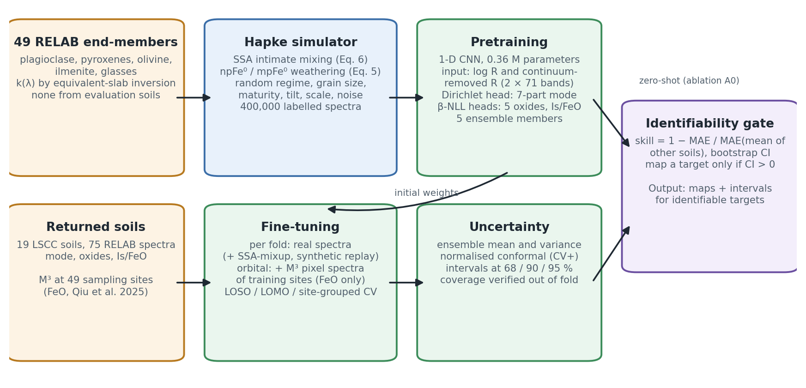
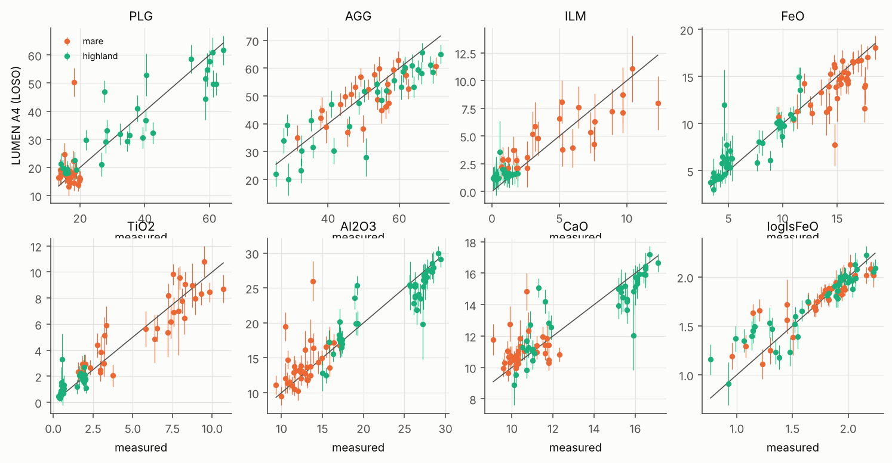
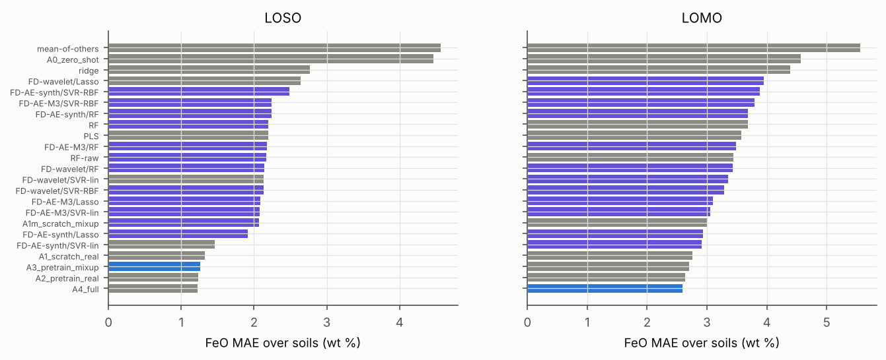
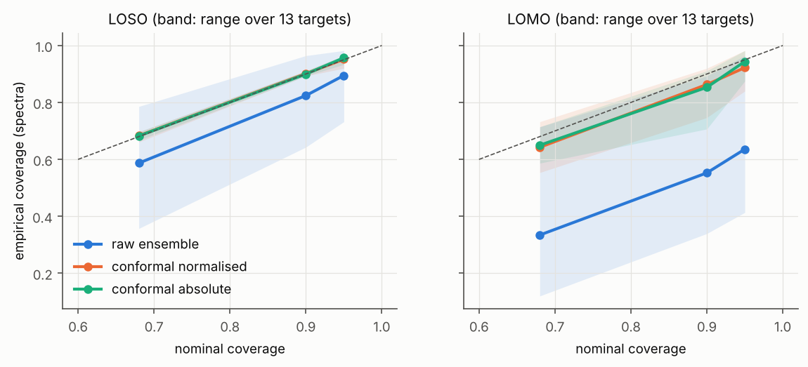
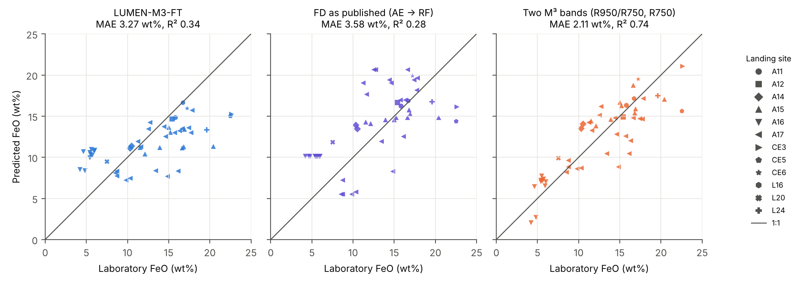
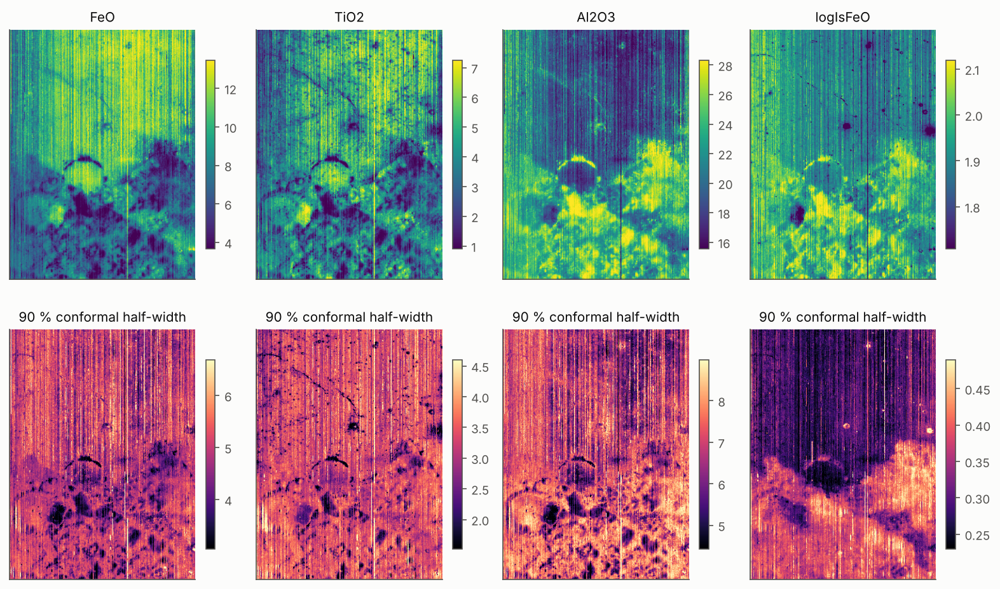

# Physics-Pretrained, Sample-Calibrated Deep Learning for Lunar Soil FeO, Mineralogy and Maturity from Moon Mineralogy Mapper Spectra

*[Author list, affiliations and correspondence to be completed by the authors.]*

**Article type:** Article — *Remote Sensing* (MDPI)

## Highlights

**What are the main findings?**

- LUMEN is a one-dimensional convolutional network. It is pretrained on 400,000 Hapke-simulated
  lunar soils and fine-tuned on 19 returned soils. From a spectrum on the Moon Mineralogy Mapper
  (M³) band set it predicts:
  - FeO, TiO₂, Al₂O₃, CaO and MgO;
  - a seven-part modal mineralogy;
  - soil maturity.
- On identical laboratory spectra and folds, it reduces FeO error by 42% relative to a published
  wavelet–autoencoder pipeline.
- Conformal calibration gives intervals with nominal coverage. An identifiability gate withholds
  the two targets that no method predicts better than a zero-information baseline (olivine and
  minor glasses).

**What are the implications of the main findings?**

- Most of the error of physics-only inversions is removed by calibrating against returned
  soils, not by adding model complexity.
- Laboratory skill does not transfer to orbital spectra without orbital labels. Fine-tuning on
  M³ spectra at returned-sample sites halves the error but does not make the deep model the best
  orbital FeO method: under leave-one-landing-site-out it reaches 3.27 wt% (R² = 0.34). That is
  lower than the published wavelet–autoencoder pipeline (3.58 wt%), though not significantly,
  and significantly higher than a linear regression on two M³ bands (2.11 wt%, R² = 0.74).

## Abstract

Retrievals of lunar surface composition from reflectance spectra fall into three groups:
- empirical band-ratio and machine-learning regressions calibrated on a few dozen returned-sample
  sites;
- radiative-transfer inversions;
- physics-guided neural networks.

They are rarely compared on identical data, and their uncertainties are seldom calibrated. We
present LUMEN (LUnar Mineralogy Estimation Network), a hybrid of physics simulation and deep
learning:
- a domain-randomised Hapke simulator, built from 49 lunar mineral and glass spectra and including
  nanophase-iron space weathering, generates 400,000 synthetic soils;
- a compact one-dimensional convolutional network is pretrained on them, then fine-tuned on
  laboratory spectra of the 19 Lunar Soil Characterization Consortium soils;
- a deep ensemble with conformal calibration supplies prediction intervals;
- an identifiability gate withholds outputs without demonstrable skill.

Under leave-one-soil-out evaluation, with the protocol fixed and committed before scoring, LUMEN
predicts FeO to 1.26 wt% and TiO₂ to 0.70 wt%. It reduces the FeO error of a re-implemented
wavelet–autoencoder pipeline by 42% (1.26 vs. 2.17 wt%) and the mineral-proportion errors of a
Shkuratov-model inversion by 54–74%. Conformal intervals reach nominal coverage. Olivine is not
identifiable from these spectra.

On M³ spectra at 49 returned-sample sites, a lab-only model does not transfer (FeO MAE 6.81
wt%). With orbital fine-tuning it reaches 3.27 wt% (R² = 0.34) under leave-one-landing-site-out:
below the published pipeline's 3.58 wt%, but not significantly (Holm p = 1.00). Two-band linear
regressions are significantly more accurate (M³: 2.11 wt%; Clementine: 1.82 wt%).

**Keywords:** lunar regolith; FeO; mineral abundance; space weathering; Moon Mineralogy Mapper;
Hapke model; deep learning; transfer learning; conformal prediction; uncertainty quantification

## 1. Introduction

Some properties of the lunar regolith can be read remotely, and they are central to lunar science
and to planning in situ resource use:
- its iron and titanium content;
- its modal mineralogy;
- its exposure to space weathering.

The Moon Mineralogy Mapper (M³) on Chandrayaan-1 acquired visible to near-infrared reflectance
spectra over most of the lunar surface [1,2]. These spectra carry the
crystal-field absorptions of Fe²⁺ in pyroxene and olivine near 1 and 2 µm, together with the
darkening and reddening produced by nanophase metallic iron. Turning such spectra into
quantitative composition remains an inverse problem with little ground truth.

**Empirical methods** relate spectral parameters to the composition of returned samples at their
landing sites.
- *Band ratios and band parameters.* The Clementine band-ratio algorithms of Lucey et al.
  [3] remain the reference for FeO and TiO₂. Band-depth and band-centre parameters of
  the 1 and 2 µm absorptions have been calibrated for M³ [4,5].
- *Regression and machine learning.* Methods range from partial least squares [6] and
  neural networks [7] to support vector machines [8] and systematic comparisons of
  regressors [9].
- *Deep learning with new ground truth.* Convolutional networks trained on Kaguya Multiband Imager
  spectra produced global oxide maps once Chang'e-5 [10,11] and Chang'e-6
  [12] samples were added. Comparable approaches use Diviner thermal data [13],
  gradient boosting [14] and random forests [15].
- *The method this study builds on.* Fernández-Díaz et al. [16] combined a db4
  wavelet decomposition, a deep autoencoder and a random-forest regressor to produce a global M³
  FeO map at 150 m per pixel.

All of these methods are trained on about 50 sampling sites. Their accuracy is reported from
random splits or small hold-out sets, rarely on identical data alongside competing methods, and
rarely against a zero-information baseline.

**Physics-based methods** model reflectance with radiative transfer.
- *Models.* The Hapke model [17] and its treatment of nanophase iron
  [18–20] support inversions for mineral abundance, grain size and
  submicroscopic iron [21–23].
- *Fast inversion with networks.* The Shkuratov model [24] was inverted on M³ with a
  neural network trained on synthetic spectra [25].
- *Posteriors.* Hapke inversions have been embedded in Bayesian samplers to obtain posterior
  abundances [26].
- *Physics-guided unmixing.* PGU-Net [27] placed a Hapke single-scattering-albedo mixing
  layer inside a deep autoencoder for unsupervised unmixing. Its M³ results were validated
  indirectly, against Kaguya products, and the authors name sample-informed priors from returned
  materials as the next step.

Physics inversions are interpretable but non-unique, and they are sensitive to the end-member set
and to the optical-constant model. Laboratory studies of the Lunar Soil Characterization
Consortium (LSCC) soils have also combined spectra with measured mineralogy:
- hybrid partial-least-squares and neural-network models [28];
- conversion of unmixing weights to mass fractions [29];
- multilayer-perceptron abundance mapping [30].

**Our reproductions of three recent methods [16,25,26]**, made
independently of this study, show where these approaches fall short.
- *Korokhin et al. [25].* On its own synthetic test set, the network recovers
  orthopyroxene, olivine and the grey absorber with R² of only 0.06, 0.17 and 0.32. Yet these
  quantities are mapped.
- *Jung et al. [26].* Abundances drawn from the prior alone, using no spectral data,
  already meet two of the three published accuracy bounds.
- *Fernández-Díaz et al. [16].* The autoencoder lowers rather than raises regression
  accuracy: a random forest on the raw wavelet coefficients is more accurate than one on the
  autoencoder codes.

None of these points is a criticism of the physical models themselves. Each concerns how much of
a retrieved number is determined by the spectrum, and how that is tested.

**What is missing** is a method that does four things at once:
- uses physics where it helps, as a source of training data;
- lets returned soils correct the physics;
- states its uncertainty and which outputs it cannot identify;
- is evaluated against published physics-based and deep-learning pipelines on identical data,
  under grouped cross-validation, with a zero-information baseline.

To address this, we propose LUMEN (LUnar Mineralogy Estimation Network). The main contributions
are:

(1) **A hybrid method, LUMEN.** It joins physics simulation and supervised learning for lunar
soil composition.
- A domain-randomised Hapke simulator generates 400,000 synthetic soils. It uses 49 lunar mineral
  and glass end-members (none taken from an evaluation soil) and physically modelled nanophase-
  and microphase-iron weathering.
- A compact one-dimensional convolutional network is pretrained on them and fine-tuned on
  returned soils.
- From one spectrum the network predicts seven-part modal mineralogy, five oxides and maturity.
- A deep ensemble with conformal calibration supplies intervals with verified coverage. An
  identifiability gate withholds every target whose skill over a zero-information baseline is not
  demonstrable.

(2) **An identical-data, protocol-fixed comparison.** LUMEN is compared with three published
methods (wavelet–autoencoder regression [16], Shkuratov-model inversion
[25] and Hapke–Bayesian inversion [26]) and with classical regressors.
- All methods use the same 75 laboratory spectra and the same leave-one-soil-out and
  leave-one-mission-out folds.
- The tests are paired and corrected for multiple comparisons.
- Every evaluation choice was committed to version control before the first score was computed.
  Negative and null results are reported alongside the positive ones.

(3) **A test of laboratory-to-orbit transfer.** It uses M³ spectra at the returned-sample sites
on which the base method was calibrated [16,31].
- It uses both that method's own cross-validation and a spatially honest leave-one-landing-site-out
  protocol.
- It shows that laboratory accuracy does not carry over to orbit without orbital labels, how
  much a small orbital fine-tuning set recovers, and that simple two-band regressions remain more
  accurate on orbit.

The remainder of this article is organised as follows:
- Section 2 describes the data, the physical preliminaries and the proposed method.
- Section 3 details the experimental settings and reports the results.
- Section 4 discusses them, including limitations.
- Section 5 concludes.

## 2. Materials and Methods

### 2.1. Data and Preprocessing

#### 2.1.1. Laboratory Spectra and Ground Truth

We use the LSCC suite [32,33]: nine mare soils (Apollo 11, 12, 15 and 17) and
ten highland soils (Apollo 14 and 16).
- **Spectra.** Each soil was sieved into <10, 10–20, 20–45 and <45 µm fractions. Each fraction
  was measured at the Reflectance Experiment Laboratory (RELAB) [34] at an incidence of
  30° and emission of 0°. The 10–20 µm spectrum of soil 70181 is absent from the archive, leaving
  75 spectra.
- **Modal mineralogy.** Point-count modal mineralogy (vol%) is available for the three finer
  fractions (56 spectra). It is merged into seven parts:
  - plagioclase (PLG);
  - low-Ca pyroxene (LCP: orthopyroxene plus pigeonite);
  - high-Ca pyroxene (HCP);
  - olivine (OLV);
  - ilmenite (ILM);
  - agglutinitic glass (AGG);
  - other (volcanic glass, K-rich phases and minor phases; OTH).
- **Chemistry and maturity.** Bulk FeO, TiO₂, Al₂O₃, CaO and MgO (wt%) and the ferromagnetic
  resonance maturity index Is/FeO are available for all 75 spectra.

The tables were transcribed from the published sources and checked against their own column sums
and totals (81 checks for the mare tables).

Every spectrum is convolved to the 71 M³ global-mode bands between 540.8 and 2497.1 nm, using
Gaussian responses with a full width at half maximum equal to the band spacing. These 71 bands
exclude the shortest-wavelength channels and the thermally affected channels beyond 2.5 µm.

#### 2.1.2. End-Member Library

The simulator draws on 49 RELAB spectra of lunar mineral separates and glasses: 17 plagioclase,
7 low-Ca and 11 high-Ca pyroxene, 6 olivine, 4 ilmenite, 2 volcanic and 2 synthetic lunar
glasses.
- They come from mare basalts, highland rocks, one non-LSCC soil (62241) and synthetic glasses.
- Every label was verified against its PDS4 metadata.
- A rule checked automatically at staging ensures that **no end-member derives from any of the 19
  evaluation soils**.
- Because every RELAB agglutinate separate comes from an LSCC soil, agglutinates are not taken
  from the library. They are modelled physically (Section 2.3.1).

#### 2.1.3. M³ Data

All orbital data are M³ Level-2 global-mode reflectance [2]. Two kinds of M³ data are
used.

**Scenes for mapping:**
- the Shapley-region strip M3G20090728T214215 analysed by Korokhin et al. [25];
- a block around the Apollo 16 landing site (M3G20090607T110414);
- the two Aristarchus regions of interest of Jung et al. [26].

**Returned-sample sites.** The FeO ground truth of the base method [16] is the
compilation of Qiu et al. [35], available in open access as Supplementary Table 1 of
Qiu et al. [31]. It lists 49 distinct, station-level sampling sites with laboratory FeO:
- Apollo 11, 12, 14, 15, 16 and 17 landing sites and traverse stations;
- Luna 16, 20 and 24;
- Chang'e-3, -5 and -6.

The table also gives Clementine reflectances at 415, 750, 900, 950 and 1000 nm for each site. We
verified it against the worked example in [16] (Apollo 17 LRV-12, 17.4 wt% FeO, at the
coordinates given in that paper).

**Site spectra.** For each site:
- every M³ strip whose nearest pixel lies within 0.01° of the site, and at least five samples from
  either swath edge, contributes the 3 × 3-pixel block around that pixel;
- pixels with any non-finite, non-positive or ≥1 reflectance are dropped;
- a strip contributes only if at least 5 of its 9 pixels remain;
- the site spectrum is the per-band median over the contributing strips.

All 49 sites are covered, Chang'e-5 included: 183 strips contribute, between one and six per site
(median four). Validity is assessed on M³ bands 3–85, the band set of [16].

Only the required image lines are downloaded, with HTTP range requests to the Planetary Data
System. Every input file is listed in a SHA-256 manifest, which each processing stage verifies at
start and end.

### 2.2. Preliminaries: Hapke Model, Single-Scattering Albedo and Space Weathering

#### 2.2.1. Reflectance and Single-Scattering Albedo

For an intimate particulate mixture we use the Hapke bidirectional reflectance [17] in the
form

$$ r(w) = \frac{w}{4(\mu_0+\mu)}\,H(w,\mu_0)\,H(w,\mu), \tag{1} $$

where:
- $w$ is the single-scattering albedo (SSA);
- $\mu_0$ and $\mu$ are the cosines of the incidence and emission angles (30° and 0° for RELAB);
- the phase function is isotropic and the opposition effect is neglected, which suits RELAB
  geometry;
- $H$ is the approximate Chandrasekhar function,

$$ H(w,x) = \left[1 - w\,x\left(r_0 + \frac{1-2r_0x}{2}\ln\frac{1+x}{x}\right)\right]^{-1},\qquad r_0=\frac{1-\gamma}{1+\gamma},\ \gamma=\sqrt{1-w}. \tag{2} $$

Equation (1) is monotonic in $w$. It is inverted numerically from a dense table.

#### 2.2.2. Equivalent-Slab Grain Optics

The SSA of a grain population with absorption coefficient $\alpha$, real index $n$, imaginary
index $k$ and size $D$ follows the equivalent-slab model [17]:

$$ w = S_e + (1-S_e)\,\frac{(1-S_i)\,\Theta}{1-S_i\,\Theta},\qquad \Theta = e^{-\alpha\langle D\rangle}, \tag{3} $$

with

$$ S_e = \frac{(n-1)^2+k^2}{(n+1)^2+k^2} + 0.05,\qquad S_i = 1.014 - \frac{4}{n(n+1)^2},\qquad \langle D\rangle = \frac{2}{3}\left[n^2-\frac{1}{n}(n^2-1)^{3/2}\right]D, \tag{4} $$

and $\alpha = 4\pi k/\lambda$ for a pure phase.

For each end-member we invert Equations (1)–(4) at the separate's nominal grain size to obtain
$k(\lambda)$.
- The reflectance is not monotonic in $k$: it falls to an opacity floor and then rises as surface
  reflection grows. The root is therefore bracketed on the physical, falling branch.
- After this correction, every end-member reproduces its own measured reflectance to
  < 10⁻¹⁰.

#### 2.2.3. Space Weathering

Nanophase metallic iron (npFe⁰) at volume fraction $\phi$ in a host of refractive index $n_h$ adds
an absorption [18,19]

$$ \alpha_{np}(\lambda) = \frac{36\pi\, z(\lambda)\,\phi}{\lambda},\qquad z = \frac{n_h^3\, n_{Fe}\, k_{Fe}}{\left(n_{Fe}^2-k_{Fe}^2+2n_h^2\right)^2+\left(2n_{Fe}k_{Fe}\right)^2}, \tag{5} $$

where $n_{Fe}$ and $k_{Fe}$ are the optical constants of iron. Microphase iron (mpFe⁰) is a grey
absorber, $\alpha_{mp} = 3\phi_{mp}/(4 r_{mp})$ with $r_{mp} = 0.1$ µm. It darkens without
reddening [19].

#### 2.2.4. Intimate Mixing

Components with volume fractions $f_i$, grain sizes $D_i$ and SSAs $w_i$ mix in SSA with
cross-section weights:

$$ w_{mix} = \frac{\sum_i (f_i/D_i)\,w_i}{\sum_i f_i/D_i}. \tag{6} $$

The mixed SSA is then converted to reflectance with Equation (1).

### 2.3. Proposed Method: LUMEN

Figure 1 summarises the method. It has four stages:
1. a physics simulator generates labelled synthetic soils;
2. a network is pretrained on them;
3. it is fine-tuned on returned soils (and, for orbital use, on orbital spectra);
4. an uncertainty and identifiability layer decides what is reported.

**Figure 1.** LUMEN workflow. The simulator (left) produces labelled synthetic spectra from 49
lunar end-members with physically modelled space weathering. The network is pretrained on them,
then fine-tuned on laboratory spectra of returned soils, and optionally on M³ spectra at
returned-sample sites. A five-member ensemble with conformal calibration gives the intervals, and
the identifiability gate decides which targets are mapped.

#### 2.3.1. Domain-Randomised Physics Simulator

Each synthetic soil draws the following.

**Composition.**
- A petrological regime: feldspathic, basaltic or broad. Each is a Dirichlet prior on the
  crystalline proportions (PLG, LCP, HCP, OLV, ILM), truncated at ≤20% ilmenite and ≤60% olivine
  of the crystalline fraction.
- A maturity, which sets the agglutinate fraction (AGG = clip(0.65 · maturity + N(0, 0.12), 0,
  0.75)) and the npFe⁰ and mpFe⁰ loads. Agglutinates are a glass host (a mixture of a feldspathic
  and a mafic synthetic glass) carrying these iron loads.
- An "other" fraction.
- One end-member per mineral phase.

**Physical and instrumental variation.**
- Grain sizes between 4 and 150 µm.
- A calibration tilt, a ±7% scale factor and 0.2–0.8% noise.

**Labels.** Chemistry labels follow from stoichiometry. Each end-member carries a nominal phase
chemistry with ±15% jitter and molar Fe–Mg exchange. Agglutinates carry the bulk composition of
the non-agglutinate fraction.

**Maturity scale.** The pretraining maturity target is set by Is/FeO = 2270 · npFe⁰ (wt%)/FeO
(wt%). This constant fixes only the scale, which fine-tuning re-learns.

**Set size.** Four hundred thousand spectra are generated with a fixed seed.

#### 2.3.2. Network

**Input.** Two channels on the 71 bands: log reflectance, and convex-hull continuum-removed
reflectance. Each is standardised per band with statistics of the synthetic set only, so no
real-data statistic enters the input.

**Body.**
- Five one-dimensional convolutions with 32, 32, 64, 64 and 64 channels and kernel sizes 7, 5, 5,
  3 and 3.
- Each is followed by group normalisation (8 groups) and a GELU activation.
- Max-pooling after the second and fourth convolutions.
- Group normalisation replaces batch normalisation because fine-tuning batches are small.

**Trunk.** The 64 × 17 feature map is flattened and mapped through layers of 256 and 128 units
(GELU, dropout 0.1). The network has 0.36 M parameters.

**Heads.**
- A **Dirichlet head** outputs concentrations $\boldsymbol\alpha = \mathrm{softplus}(\cdot)+0.05$
  for the seven-part composition. Its mean $\boldsymbol\alpha/\alpha_0$, with
  $\alpha_0=\sum_j\alpha_j$, is the predicted composition.
- **Heteroscedastic Gaussian heads** output a mean and a log-variance for each oxide and for
  log₁₀(Is/FeO).
- **Auxiliary heads** for log grain size and npFe⁰ are used during pretraining only.

#### 2.3.3. Objective Functions

The composition loss is the Dirichlet negative log-likelihood of the label-smoothed proportions,
$\tilde{\mathbf y} = (\mathbf y+\epsilon)/(1+7\epsilon)$ with $\epsilon = 0.005$, plus an $L_1$
term on the mean:

$$ \mathcal L_{comp} = -\frac{1}{7}\left[\ln\Gamma(\alpha_0) - \sum_j \ln\Gamma(\alpha_j) + \sum_j(\alpha_j-1)\ln\tilde y_j\right] + \lambda_1\,\frac{1}{7}\sum_j\left|\frac{\alpha_j}{\alpha_0} - y_j\right|. \tag{7} $$

The weight $\lambda_1 = 10$ was fixed on synthetic data only.

The scalar targets use the β-negative log-likelihood [36], with $\beta=0.5$. It avoids
the under-fitting of high-variance points that the plain Gaussian likelihood causes:

$$ \mathcal L_{scal} = \frac{\sum_t m_t\,\mathrm{sg}\!\left[\sigma_t^{2\beta}\right]\tfrac12\left(\ln\sigma_t^2 + \frac{(y_t-\mu_t)^2}{\sigma_t^2}\right)}{\sum_t m_t}, \tag{8} $$

where:
- $\mathrm{sg}$ stops the gradient;
- $m_t$ masks targets that are unavailable for a sample (modal mineralogy for the <45 µm
  fraction; all targets except FeO for orbital spectra).

The total loss is $\mathcal L_{comp} + \mathcal L_{scal}$. During pretraining it also includes the
auxiliary β-NLL terms.

#### 2.3.4. Training

**Pretraining.** Five ensemble members are pretrained on the synthetic set with different seeds:
15 epochs, AdamW, a one-cycle learning-rate schedule, and 20,000 spectra held out for validation.

**Fine-tuning.** Each member is fine-tuned per cross-validation fold for 1500 steps: AdamW,
learning rate 3 × 10⁻⁴, weight decay 10⁻⁴, 100 warm-up steps, then cosine decay. The full
configuration (A4) draws each step:
- 16 real training spectra;
- 32 **SSA-space mixup** spectra. Each is a Dirichlet-weighted mixture of 2–3 training spectra,
  mixed with Equation (6) using their nominal fraction sizes. Labels are mixed exactly:
  composition by volume, chemistry by mass, and Is/FeO weighted by mass × FeO;
- 16 synthetic replay spectra.

Real and mixed spectra receive the simulator's calibration and noise randomisation. The simpler
configuration A2 uses the real spectra only.

All hyperparameters were fixed from synthetic-only development runs and committed before any
model was scored on real folds.

#### 2.3.5. Uncertainty and Identifiability

**Ensemble.** The ensemble mean is the mean of the member means. The ensemble variance is the mean
of the member variances plus the variance of the member means [37].

**Conformal intervals.** Raw ensemble intervals are over-confident (Section 3.5), so we calibrate
them conformally [38].
- The normalised score $s_i = |y_i - \mu_i|/\sigma_i$ is computed from out-of-fold predictions of
  the other soils.
- Its $\lceil (1-a)(n+1)\rceil$-th smallest value $q_{1-a}$ gives the interval
  $\mu \pm q_{1-a}\,\sigma$.
- The exact CV+ variant uses models from which both the calibration soil and the test soil were
  held out (930 additional fine-tunes).

**Identifiability gate.** For each target, the skill is

$$ S = 1 - \frac{\mathrm{MAE}}{\mathrm{MAE}_{ref}}, \tag{9} $$

where $\mathrm{MAE}_{ref}$ is the error of the fraction-matched mean of the other soils, a
zero-information reference. A 95% bootstrap interval is computed over soils. A target is mapped
only if the lower bound of that interval is above zero under leave-one-soil-out evaluation.

#### 2.3.6. Transfer to M³

Laboratory and M³ reflectance differ in absolute scale.

**Zero-shot application.** M³ spectra are brought to the laboratory scale with the linear
calibration of Korokhin et al. [25]:

$$ A_{lab} = 1.685\,A_{M^3} + 0.0355. \tag{10} $$

For a site of Apollo mission X, the zero-shot model is the ensemble fine-tuned with all of mission
X's soils held out. For the Luna and Chang'e sites it is the ensemble fine-tuned on all 19 soils.

**Orbital fine-tuning (LUMEN-M3-FT).** The network is further fine-tuned for 600 steps (AdamW,
learning rate 10⁻⁴, weight decay 10⁻⁴, cosine decay). Each batch holds:
- 16 M³ pixel spectra from the training sites, labelled with their site FeO, with every other
  target masked;
- 16 laboratory spectra from that model's own training soils, with all targets.

The held-out site is predicted from its site spectrum.

## 3. Results

### 3.1. Experimental Setup

#### 3.1.1. Comparison Algorithms

On the laboratory spectra, LUMEN is compared with the following methods. All are trained and
scored on identical spectra and folds.

**Classical baselines**
- **Mean of other soils.** The fraction-matched mean of the training soils, a zero-information
  reference.
- **Classical regressors on LUMEN's inputs.** Partial least squares (PLS), ridge regression and a
  random forest (RF), all using the same 142 input values as LUMEN (2 channels × 71 bands).
- **RF on raw reflectance.**
- Hyperparameters of every classical baseline are tuned by inner grouped cross-validation on the
  training soils only.

**Fernández-Díaz et al. [16], re-implemented in full on the same 71-band spectra**
- A two-level db4 wavelet decomposition (periodisation), keeping the A2 and D2 coefficients.
- An autoencoder 42 → 32 → 16 → 6 → 16 → 32 → 42, trained unsupervised either on M³ pixels (as
  published) or on our synthetic spectra.
- Four regressors (Lasso, linear SVR, RBF SVR, RF), with the paper's search grids, tuned by inner
  cross-validation.
- The no-autoencoder variant (wavelet coefficients → regressor).
- Twelve variants in total. "FD as published" denotes the M³-trained autoencoder followed by RF.

**Korokhin et al. [25] and Jung et al. [26]**
- Their outputs on the LSCC soils come from independent reproductions of each method. Each
  reproduction was validated against the paper's printed numbers: 46 of 65 and 32 of 34 gated
  targets reproduced.
- Each method is scored exactly as the paper scores itself (Section 3.4).

**On M³ (Section 3.6)**
- Four LUMEN variants: zero-shot (Section 2.3.6); zero-shot followed by a linear recalibration
  $y = a + b\hat y$ fitted on the training sites; LUMEN-M3-FT (Section 2.3.6); and a ridge
  regression on the 128-dimensional trunk embedding, averaged over members ("LUMEN-embed +
  ridge", α chosen by inner leave-one-site-out).
- The Fernández-Díaz variants, retrained on M³ site spectra.
- A linear model on two M³ bands (R950/R750 and R750).
- The Lucey θ parameter [3], refitted on M³.
- The Lucey et al. published constants applied to the Clementine reflectances of the ground-truth
  table, plus a two-band Clementine model refitted.
- The training-fold mean.

#### 3.1.2. Parameter Settings

Table 1 lists the fixed settings.
- All LUMEN hyperparameters were set from synthetic-only development runs.
- They were committed to version control, together with the evaluation protocol, before any model
  was scored on real folds.
- No hyperparameter was tuned on a held-out soil.
- The later experiments (the nested selection of Section 3.3, Section 3.6 and the design
  alternatives of Section 3.7) were committed in the same way before they were run.

**Table 1.** Fixed LUMEN settings.

| Component | Setting |
|---|---|
| Simulator | 400,000 spectra; 49 end-members; grain size 4–150 µm; scale ±7%; noise 0.2–0.8% |
| Input | 2 × 71 (log R, continuum-removed R), standardised with synthetic statistics |
| Network | 5 conv layers (32/32/64/64/64; kernels 7/5/5/3/3), GroupNorm, GELU, 2 max-pools, trunk 256→128; 0.36 M parameters |
| Losses | Dirichlet NLL + L1 (λ₁ = 10, ε = 0.005); β-NLL (β = 0.5) |
| Pretraining | 5 members, 15 epochs, AdamW, one-cycle, batch 512 |
| Fine-tuning | 1500 steps, AdamW lr 3 × 10⁻⁴, wd 10⁻⁴, warm-up 100, cosine; batch 16 real + 32 SSA-mixup + 16 replay (A4) |
| Orbital fine-tuning | 600 steps, lr 10⁻⁴, batch 16 M³ + 16 lab spectra |
| Uncertainty | 5-member ensemble; normalised conformal (CV+) intervals; gate on bootstrap skill CI |
| Hardware | CPU only (4 cores); pretraining ≈ 45 min; one fine-tune ≈ 6 s |

#### 3.1.3. Evaluation Protocols and Metrics

**Protocols**
- **Leave-one-soil-out (LOSO, 19 folds).** All four fractions of the held-out soil are excluded
  from fine-tuning, from mixup and from normalisation statistics.
- **Leave-one-mission-out (LOMO, 6 folds: A11, A12, A14, A15, A16, A17).** This is the
  out-of-distribution test. Holding out A16 removes every feldspathic soil, and holding out A17
  every high-Ti soil.

**Metrics**
- The primary metric is the per-soil mean absolute error (MAE): each soil's labelled fractions are
  averaged, then the 19 soils are averaged. The number of independent units is therefore the
  number of soils, not the number of spectra.
- R² and RMSE are reported per spectrum.
- Methods are compared with paired Wilcoxon signed-rank tests over soils [39], with
  Holm correction [40] over the 13 targets or over the comparators.
- Bootstrap confidence intervals are computed over soils.

### 3.2. Simulator Validation

Every self-test of the simulator passes.

| Test | Result |
|---|---|
| Round trip (each end-member's k(λ) reproduces its measured reflectance) | to 7.8 × 10⁻¹¹ |
| Truncated prior: 99th-percentile synthetic TiO₂ | 30.5 → 14.0 wt% (LSCC maximum 10.7) |
| Truncated prior: 99th-percentile synthetic FeO | 31.8 → 24.4 wt% |
| Label model (modal composition × phase chemistry vs measured bulk oxides) | r = 0.93–0.98, but mare TiO₂ biased by +2.9 wt% (affects only the scale of the pretraining labels) |
| Coverage: median nearest-synthetic-neighbour distance of the 75 LSCC spectra | 0.102, vs 0.144 between synthetic spectra; the real data lie inside the synthetic distribution |
| Separability: AUC of a classifier separating real from synthetic spectra | 0.97 (0.99 against noise-free synthetics); real soils are redder than their nearest synthetic neighbours |
| Measured <45 µm spectra reproduced by mixing their sieve fractions | to 0.6% RMS |

The last two rows matter for what follows. The real spectra sit inside the synthetic
distribution, yet remain separable from it: this is the sim-to-real gap that fine-tuning must
close.

### 3.3. Accuracy on the LSCC Soils

Table 2 gives per-soil MAEs.

**Leave-one-soil-out (LOSO)**
- **Skill.** Against the zero-information reference, LUMEN (A4) has a skill of 0.50 for
  composition and 0.72 for FeO.
- **Against classical baselines.** A4 has the lower error than each classical baseline on 12 of
  13 targets; the exception is always olivine. After Holm correction it is significantly better
  than PLS on 9 targets and than the mean of other soils on 10.
- **Against the strongest baseline**, a random forest on the same inputs, A4 is lower on 12 of 13
  targets. Only maturity is significant after correction (for FeO, raw p = 0.005, Holm p = 0.064).

**Leave-one-mission-out (LOMO)**
- Every method degrades. A4's composition MAE rises from 2.66 to 4.70 vol% and its FeO MAE from
  1.26 to 2.59 wt%.
- A4 remains lower than RF on 10 of 13 targets, and significantly so for LCP, HCP and TiO₂.
- For the "other" class, no method beats the zero-information reference.

**Table 2.** Per-soil MAE, LOSO / LOMO (composition in vol%, oxides in wt%, maturity in log₁₀
Is/FeO). Bold: lowest per row and protocol.

| Target | Mean of others | PLS | Ridge | RF | LUMEN (A4) |
|---|---|---|---|---|---|
| PLG | 14.09 / 17.74 | 11.13 / 16.66 | 10.58 / 16.68 | 7.13 / 12.45 | **4.82 / 11.31** |
| LCP | 3.23 / 3.89 | 2.40 / 3.69 | 2.38 / 3.47 | 2.23 / 3.33 | **1.75 / 2.50** |
| HCP | 2.89 / 3.49 | 1.92 / 1.72 | 1.78 / 1.78 | 1.57 / 1.93 | **1.07 / 1.22** |
| OLV | 0.93 / 1.05 | 0.87 / 1.06 | 0.87 / 1.03 | **0.84 / 0.98** | 0.98 / 1.13 |
| ILM | 2.63 / 3.22 | 1.89 / 2.18 | 1.81 / 2.10 | 1.68 / 2.30 | **1.22 / 1.69** |
| AGG | 9.60 / 9.53 | 9.85 / 12.29 | 9.29 / 11.86 | 7.14 / 9.94 | **5.78 / 9.18** |
| OTH | 3.85 / **4.81** | 3.62 / 5.34 | 3.45 / 5.22 | 3.37 / 5.41 | **3.02** / 5.88 |
| FeO | 4.47 / 5.56 | 2.77 / 3.58 | 2.64 / 4.39 | 2.13 / 3.69 | **1.26 / 2.59** |
| TiO₂ | 2.67 / 3.28 | 1.70 / 2.30 | 1.63 / 1.90 | 1.43 / 2.27 | **0.70 / 1.37** |
| Al₂O₃ | 6.00 / 7.53 | 4.03 / 5.90 | 3.65 / 6.44 | 2.84 / 5.41 | **1.71 / 4.33** |
| CaO | 2.41 / 3.04 | 1.87 / 2.98 | 1.72 / 3.20 | 1.23 / 2.43 | **0.87 / 2.20** |
| MgO | 1.99 / 2.50 | 1.40 / 2.21 | 1.31 / 2.12 | 0.92 / **1.71** | **0.78** / 1.74 |
| log₁₀ Is/FeO | 0.31 / 0.30 | 0.20 / 0.24 | 0.22 / 0.21 | 0.20 / 0.23 | **0.11 / 0.15** |
| Composition (mean) | 5.32 / 6.25 | 4.53 / 6.13 | 4.31 / 6.02 | 3.42 / 5.19 | **2.66 / 4.70** |

**Configuration chosen inside the cross-validation (E1).** The pre-registered primary model, A4,
is not the best configuration (Section 3.7). We therefore re-ran the choice between A4 and the
simpler A2 inside each outer training fold, by inner five-fold grouped cross-validation, so that
the outer-fold estimate stays confirmatory.
- **Selection.** The inner score favoured A2 in every outer fold: 19 of 19 under LOSO and 6 of 6
  under LOMO. "LUMEN-selected" is therefore A2 throughout.
- **Outer errors (LOSO).** Composition 2.35 vol%, FeO 1.23 wt%, TiO₂ 0.55 wt% and maturity 0.12
  (log₁₀ Is/FeO).
- **Primary test, LUMEN-selected vs RF (LOSO).** LUMEN-selected is lower on 12 of 13 targets; the
  exception is again olivine (0.86 vs 0.84 vol%). After Holm correction over the 13 targets, it is
  significantly better on 8: PLG, LCP, HCP, ILM, FeO, TiO₂, Al₂O₃ and maturity. For FeO, 1.23 vs
  2.13 wt%, raw p = 0.001, Holm p = 0.011.
- **Other baselines (LOSO).** Significant on 11 of 13 targets against PLS and against ridge, and on
  10 against the mean of other soils.
- **LOMO (secondary).** Composition 4.77 vol%, FeO 2.63 wt%. LUMEN-selected is lower than RF on
  10 of 13 targets (not for OLV, OTH and MgO), and significantly so on 6: LCP, HCP, FeO, TiO₂,
  Al₂O₃ and maturity.
- **A4 vs A2, re-run.** No difference is significant under either protocol; A4 is lower on 1 of
  13 targets under LOSO and 5 of 13 under LOMO.

These runs use pretrained members regenerated on a different machine. Re-running A2 and A4 with
them reproduces the stored per-soil MAEs to within 0.06 (in each target's unit) for every target,
configuration and protocol.

**Figure 2.** LUMEN (A4) predictions against measured values for the 19 LSCC soils under LOSO.

### 3.4. Comparison with Published Methods

#### 3.4.1. Wavelet–Autoencoder FeO Regression [16]

This is the fairest comparison: the pipeline is trained on exactly the same spectra and folds as
LUMEN (Table 3).

**LOSO**
- LUMEN's FeO MAE is 1.26 wt% (R² = 0.85).
- FD as published has 2.17 wt% (R² = 0.62), so LUMEN's error is 42% lower.
- The best FD variant on these data, wavelet → RBF SVR without the autoencoder, has 1.91 wt%.
- LUMEN is lower than all twelve variants. Each paired test has p < 0.05, which is the test fixed
  in the protocol. With the additional, more conservative Holm correction over the twelve
  variants, 3 of 12 remain significant (vs FD as published: Holm p = 0.069).

**LOMO**
- LUMEN has 2.59 wt%, against 3.48 for FD as published (p = 0.018) and 2.91 for the best variant
  (p = 0.49).

**The effect of the autoencoder depends on the protocol**
- Under LOSO, the M³-trained autoencoder is worse than the raw wavelet coefficients for 4 of 4
  regressors. This agrees with our reproduction of the original study, where RF on the raw
  coefficients reached 1.55 wt% against 1.95 wt% with the autoencoder.
- Under LOMO, the autoencoder helps the two linear regressors.

**Table 3.** FeO (wt%) on identical spectra and folds. "FD-AE-M3" is the published autoencoder,
trained on M³ pixels; "FD-AE-synth" is trained on our synthetic spectra; "FD-wavelet" has no
autoencoder.

| Method | MAE LOSO | R² LOSO | MAE LOMO | R² LOMO |
|---|---|---|---|---|
| **LUMEN (A4)** | **1.26** | **0.85** | **2.59** | 0.57 |
| LUMEN (A2, pretrain + real) | 1.23 | 0.86 | 2.64 | 0.58 |
| FD-AE-M3 / RF (published) | 2.17 | 0.62 | 3.48 | 0.25 |
| FD-AE-M3 / Lasso | 2.48 | 0.55 | 3.09 | 0.39 |
| FD-AE-M3 / SVR-lin | 2.19 | 0.65 | 3.06 | 0.41 |
| FD-AE-M3 / SVR-RBF | 2.06 | 0.62 | 3.79 | 0.07 |
| FD-AE-synth / SVR-lin | 2.09 | 0.65 | 2.91 | 0.48 |
| FD-wavelet / SVR-RBF | 1.91 | 0.67 | 3.28 | 0.17 |
| FD-wavelet / Lasso | 2.07 | 0.70 | 3.95 | −0.01 |
| RF (LUMEN inputs) | 2.13 | 0.62 | 3.69 | 0.16 |
| RF (raw reflectance) | 2.19 | 0.58 | 3.45 | 0.27 |
| Mean of other soils | 4.47 | −0.06 | 5.56 | −0.70 |

*(The remaining FD variants are in the repository tables.)*

**Figure 3.** FeO error of LUMEN and of the Fernández-Díaz et al. variants on identical folds.

#### 3.4.2. Shkuratov-Model Inversion [25]

Each method is scored on five-mineral proportions (CPX, OPX, OLV, PLG, ILM, renormalised to 100%)
over the three sieved fractions, as the reproduction of Korokhin et al. scores itself (Table 4).

**LOSO**
- LUMEN reduces the error for every mineral by 54–74%. Every difference is Holm-significant.
- For example: olivine 1.91 vs 7.44 points, and plagioclase 5.55 vs 12.08.

**LOMO**
- LUMEN is still lower on four of five minerals, but significantly so only for olivine. It is
  slightly worse for plagioclase (12.64 vs 12.08).

**Caveat**
- The inversion never sees an LSCC soil, whereas LUMEN is fine-tuned on the others.
- The like-for-like comparison is therefore LUMEN's zero-shot model (A0, physics-trained only). It
  is lower on three of five minerals, but significantly so only for olivine.

**Maturity.** LUMEN's Is/FeO ranks the soils better than the inversion's nFe parameter. Spearman ρ
is 0.72, 0.81 and 0.96 for the <10, 10–20 and 20–45 µm fractions, against 0.55, 0.37 and 0.44.

**Table 4.** MAE of five-mineral proportions (percentage points), 19 soils.

| Mineral | Mean of others | Korokhin fit | LUMEN A0 (zero-shot) | LUMEN A4 (LOSO) | LUMEN A4 (LOMO) | Holm p, A4 vs fit (LOSO) |
|---|---|---|---|---|---|---|
| CPX | 6.78 | 5.30 | 8.18 | **2.24** | 3.14 | 0.007 |
| OPX | 9.18 | 8.37 | 8.98 | **3.25** | 6.86 | 0.007 |
| OLV | 2.21 | 7.44 | 2.58 | **1.91** | 2.50 | <0.001 |
| PLG | 18.44 | 12.08 | 10.40 | **5.55** | 12.64 | 0.007 |
| ILM | 6.26 | 5.24 | 3.06 | **2.39** | 4.06 | 0.007 |

#### 3.4.3. Hapke–Bayesian Inversion [26]

The comparison uses the four test soils of Jung et al. (12001, 12030, 15071 and 71061, 20–45 µm),
and their crystalline proportions.
- **LUMEN.** Its worst-case LOSO errors are 1.00 points (olivine), 1.24 (ilmenite) and 7.95
  (plagioclase). All three published accuracy bounds (7, 10 and 30 points) are met.
- **The converged inversion** reaches 17.56 points for ilmenite.
- **Caveat.** With four soils this is weak evidence. The zero-shot model also meets every bound,
  while the mean of other soils misses the ilmenite and plagioclase bounds.
- **Maturity.** Across the four soils, LUMEN's Is/FeO correlates with the measured value at
  r = 0.99, against r ≈ 0.00 for the inversion's maturity index.

### 3.5. Uncertainty and Identifiability

**Raw ensemble intervals are over-confident** (Figure 4). For nominal 68/90/95% intervals, mean
empirical coverage is:
- 0.59/0.82/0.89 under LOSO;
- 0.33/0.55/0.64 under LOMO.

**Normalised conformal calibration fixes this:**
- 0.68/0.90/0.95 under LOSO;
- 0.64/0.86/0.92 under LOMO.

Exact CV+ uses models that saw neither the calibration soil nor the test soil. It gives
0.69/0.90/0.96 (LOSO) and 0.70/0.88/0.93 (LOMO), so the approximation is slightly conservative out
of distribution.

**The identifiability gate passes 11 of 13 targets** (Table 5). It withholds:
- **olivine**, whose LOSO skill is −0.06 (CI −0.40 to 0.22);
- the **"other"** class (0.22, CI −0.03 to 0.42).

Under LOMO, the agglutinate fraction also loses significance (0.04, CI −0.34 to 0.25).

**Table 5.** Skill over the zero-information reference with 95% bootstrap CI.

| Target | LOSO skill [CI] | LOMO skill [CI] | Mapped |
|---|---|---|---|
| PLG | 0.66 [0.47, 0.78] | 0.36 [0.19, 0.52] | yes |
| LCP | 0.46 [0.32, 0.59] | 0.36 [0.20, 0.50] | yes |
| HCP | 0.63 [0.53, 0.71] | 0.65 [0.55, 0.74] | yes |
| OLV | −0.06 [−0.40, 0.22] | −0.08 [−0.38, 0.16] | **no** |
| ILM | 0.54 [0.40, 0.64] | 0.47 [0.36, 0.57] | yes |
| AGG | 0.40 [0.16, 0.54] | 0.04 [−0.34, 0.25] | yes |
| OTH | 0.22 [−0.03, 0.42] | −0.22 [−0.51, −0.03] | **no** |
| FeO | 0.72 [0.61, 0.80] | 0.53 [0.44, 0.60] | yes |
| TiO₂ | 0.74 [0.61, 0.82] | 0.58 [0.45, 0.65] | yes |
| Al₂O₃ | 0.71 [0.56, 0.82] | 0.43 [0.28, 0.54] | yes |
| CaO | 0.64 [0.50, 0.75] | 0.28 [0.16, 0.38] | yes |
| MgO | 0.61 [0.37, 0.77] | 0.31 [0.05, 0.47] | yes |
| log₁₀ Is/FeO | 0.63 [0.56, 0.71] | 0.50 [0.32, 0.61] | yes |

**Figure 4.** Empirical against nominal interval coverage, for the raw ensemble and after
conformal calibration, under LOSO and LOMO.

### 3.6. FeO from M³ Spectra at Returned-Sample Sites

This experiment tests the base method on its own task, orbital FeO, against the ground truth it
was calibrated on [16,31].

**Protocols**
- **P1.** The base study's own 10-fold cross-validation over sites, so the numbers are comparable
  with the published MAE of 2.29 wt%.
- **P2.** Leave-one-landing-site-out, where all stations of a mission are held out together. Those
  stations share terrain and are spatially autocorrelated, so this is the spatially honest test.

All 49 sites have M³ coverage and are scored. Table 6 gives the errors and Figure 5 shows the
P2 predictions.

**Table 6.** FeO (wt%) at the 49 returned-sample sites, P1 (10-fold, seed 42) / P2
(leave-one-landing-site-out), 3 × 3-pixel site spectra. Bias is predicted minus laboratory FeO.
Every method except the zero-shot model and the Lucey et al. constants is fitted inside each
training fold.

| Method | P1 MAE | P1 RMSE | P1 R² | P1 bias | P2 MAE | P2 RMSE | P2 R² | P2 bias |
|---|---|---|---|---|---|---|---|---|
| LUMEN-M3 (zero-shot) | 6.81 | 7.52 | −1.30 | −5.29 | 6.81 | 7.52 | −1.30 | −5.29 |
| LUMEN-M3 + recalibration | 4.39 | 5.17 | −0.09 | −0.04 | 5.11 | 6.34 | −0.63 | 0.17 |
| **LUMEN-M3-FT** | 2.20 | 3.01 | 0.63 | −1.19 | 3.27 | 4.02 | 0.34 | −1.01 |
| LUMEN-embed + ridge | 2.01 | 2.56 | 0.73 | −0.60 | 2.60 | 3.16 | 0.59 | −0.38 |
| FD-AE-M3 / RF (published) | 1.90 | 2.71 | 0.70 | 0.01 | 3.58 | 4.21 | 0.28 | 1.29 |
| FD-AE-M3 / Lasso | 2.11 | 2.71 | 0.70 | 0.01 | 3.07 | 3.78 | 0.42 | 0.78 |
| FD-AE-M3 / SVR-lin | 2.30 | 2.95 | 0.65 | −0.37 | 2.27 | 2.86 | 0.67 | −0.44 |
| FD-AE-M3 / SVR-RBF | 2.12 | 2.85 | 0.67 | −0.02 | 3.27 | 3.86 | 0.40 | 0.56 |
| FD-wavelet / RF | 1.96 | 2.72 | 0.70 | −0.32 | 3.21 | 3.88 | 0.39 | 0.72 |
| FD-wavelet / Lasso | 2.19 | 2.81 | 0.68 | −0.24 | 2.44 | 3.49 | 0.50 | 0.20 |
| FD-wavelet / SVR-lin | 2.49 | 3.16 | 0.59 | −0.61 | 2.54 | 3.41 | 0.53 | −0.02 |
| FD-wavelet / SVR-RBF | 2.40 | 3.39 | 0.53 | −0.03 | 4.39 | 5.94 | −0.44 | 1.31 |
| Two M³ bands (R950/R750, R750) | 1.99 | 2.43 | 0.76 | 0.00 | 2.11 | 2.54 | 0.74 | −0.16 |
| Lucey θ (M³, refitted) | 3.26 | 3.70 | 0.44 | 0.00 | 4.30 | 5.04 | −0.03 | −0.03 |
| Lucey et al. constants (Clementine) ᵃ | 1.25 | 1.72 | 0.88 | −0.17 | 1.25 | 1.72 | 0.88 | −0.17 |
| Two Clementine bands (refitted) | 1.34 | 1.74 | 0.88 | 0.03 | 1.82 | 2.32 | 0.78 | −0.31 |
| Training-fold mean | 4.34 | 5.07 | −0.04 | 0.00 | 4.78 | 5.69 | −0.32 | 0.03 |

ᵃ In-sample. The published constants [3] were derived from returned-sample sites, and
nothing is fitted here, so this row is not a held-out estimate and is not comparable with the
others.

**Primary test (P2).** LUMEN-M3-FT has a lower MAE than FD as published (3.27 vs 3.58 wt%), but
it is the more accurate of the two at only 24 of the 49 sites. The difference is not significant
(Wilcoxon p = 0.74; Holm p = 1.00 over the 13 comparators).

**LUMEN-M3-FT against the other comparators (P2, Holm).**
- It is significantly better only than the training-fold mean (Holm p < 0.001).
- It is significantly worse than four methods:
  - two M³ bands (2.11 wt%, Holm p = 0.009);
  - FD-AE-M3 / SVR-lin (2.27 wt%, Holm p = 0.029);
  - two Clementine bands (1.82 wt%, Holm p = 0.001);
  - the in-sample Lucey et al. constants (1.25 wt%, Holm p < 0.001).
- No other difference is significant.

**Under P1**, the base study's own protocol:
- FD as published reaches 1.90 wt%. That is close to our reproduction of the original study
  (1.95 wt%) and below the published 2.29 wt% [16].
- LUMEN-M3-FT has a higher error, 2.20 wt%. The difference is not significant (Holm p = 1.00).
- No FD variant differs significantly from LUMEN-M3-FT. The two-M³-band model does not either
  (1.99 wt%, Holm p = 1.00).
- Two Clementine bands are significantly more accurate than LUMEN-M3-FT (1.34 wt%, Holm
  p = 0.020). LUMEN-M3-FT is significantly more accurate than the refitted Lucey θ on M³ (3.26 wt%,
  Holm p = 0.020).

**Sensitivity.**
- *P1 seed.* Over six P1 seeds, LUMEN-M3-FT averages 2.13 wt% (2.08–2.20) and FD as published
  1.91 wt% (1.81–1.97), so FD as published has the lower error under every seed.
- *Single pixel.* Using each strip's centre pixel instead of the 3 × 3 block leaves the P2 picture
  unchanged. LUMEN-M3-FT has 3.26 wt% against 3.35 wt% for FD as published (Holm p = 1.00), and
  it remains significantly worse than the two M³ bands (2.02 wt%, Holm p = 0.006).

**Intervals (E6).** Under P2, normalised conformal intervals for LUMEN-M3-FT cover 0.63, 0.92 and
0.98 of the 49 sites at nominal 68, 90 and 95%. The raw ensemble intervals cover 0.51, 0.76 and
0.86. The calibrated intervals are wide: the mean half-width is 4.6 wt% at 68% and 10.6 wt% at
95%.

**Figure 5.** Predicted against laboratory FeO at the 49 returned-sample sites under P2
(leave-one-landing-site-out), for LUMEN-M3-FT, FD as published and the two-M³-band linear model.
Marker shape gives the landing site; the line is 1:1.

### 3.7. Ablations and Parameter Analysis

**Pretraining helps, but the pre-registered primary model is not the best configuration**
(Table 7).
- **Pretraining.** A2 (pretrained, fine-tuned on real spectra) has a lower error than A1 (the same
  network trained from scratch on real spectra) on all 13 targets under LOSO. The 13 targets are
  correlated, however, and no single target's difference is significant after Holm correction.
  Under LOMO, two targets are (HCP and maturity).
- **SSA-mixup and synthetic replay.** These were meant to enlarge the 18-soil training set. Added
  to the pretrained network (A4 vs A2), they lower the error on only 1 of 13 targets. No A4–A2
  difference is significant.
- **Mixup without pretraining.** Mixup does help a network trained from scratch under LOSO (lower
  on 12 of 13 targets), but not under LOMO (2 of 13).
- **Zero-shot model (A0).** The physics-only analogue of a simulator-trained inversion has a
  composition MAE of 9.1 vol%, far above every fine-tuned variant. This is the sim-to-real gap made
  concrete.

**Table 7.** Ablations: per-soil MAE, LOSO / LOMO. A4 is the pre-registered primary model.

| Target | A0 zero-shot | A1 scratch, real | A1m scratch + mixup | A2 pretrain + real | A3 pretrain + mixup | A4 full |
|---|---|---|---|---|---|---|
| PLG | 13.99 / 13.99 | 4.84 / 11.76 | 4.21 / 12.01 | 4.17 / 12.01 | 4.25 / 12.31 | 4.82 / 11.31 |
| LCP | 4.88 / 4.88 | 1.58 / 2.45 | 1.57 / 2.57 | 1.42 / 2.12 | 1.41 / 2.15 | 1.75 / 2.50 |
| HCP | 4.51 / 4.51 | 1.21 / 1.72 | 1.19 / 1.82 | 0.85 / 1.09 | 0.94 / 1.15 | 1.07 / 1.22 |
| OLV | 1.22 / 1.22 | 0.91 / 1.02 | 0.92 / 1.04 | 0.86 / 1.03 | 0.93 / 1.06 | 0.98 / 1.13 |
| ILM | 1.83 / 1.83 | 1.30 / 1.95 | 1.30 / 2.07 | 1.08 / 1.70 | 1.22 / 1.90 | 1.22 / 1.69 |
| AGG | 25.53 / 25.53 | 6.19 / 9.61 | 5.68 / 9.34 | 5.42 / 9.64 | 5.50 / 9.45 | 5.78 / 9.18 |
| OTH | 12.00 / 12.00 | 2.78 / 5.63 | 2.70 / 5.82 | 2.69 / 5.82 | 2.77 / 6.06 | 3.02 / 5.88 |
| FeO | 4.57 / 4.57 | 1.46 / 2.75 | 1.32 / 3.00 | 1.23 / 2.64 | 1.23 / 2.71 | 1.26 / 2.59 |
| TiO₂ | 3.91 / 3.91 | 0.82 / 1.43 | 0.76 / 1.57 | 0.56 / 1.08 | 0.66 / 1.36 | 0.70 / 1.37 |
| Al₂O₃ | 3.79 / 3.79 | 1.74 / 4.35 | 1.58 / 4.62 | 1.51 / 4.24 | 1.61 / 4.54 | 1.71 / 4.33 |
| CaO | 1.69 / 1.69 | 0.76 / 2.12 | 0.74 / 2.29 | 0.73 / 2.20 | 0.76 / 2.29 | 0.87 / 2.20 |
| MgO | 1.84 / 1.84 | 0.82 / 1.58 | 0.69 / 1.69 | 0.71 / 1.74 | 0.71 / 1.75 | 0.78 / 1.74 |
| log₁₀ Is/FeO | 0.30 / 0.30 | 0.15 / 0.19 | 0.14 / 0.18 | 0.12 / 0.14 | 0.13 / 0.15 | 0.11 / 0.15 |
| Composition (mean) | 9.14 / 9.14 | 2.69 / 4.88 | 2.51 / 4.95 | 2.36 / 4.77 | 2.43 / 4.87 | 2.66 / 4.70 |

**Is the network itself better than classical regression?** A1 is the same network trained from
scratch, without the physics. Against RF it is already significantly better (Holm) on 5 of 13
targets under LOSO (PLG, ILM, FeO, TiO₂ and Al₂O₃), and on 3 of 13 under LOMO. The simpler
pretrained variant A2 is significantly better than RF on 8 of 13 targets under LOSO and 6 of 13
under LOMO. A2 was identified after the fact, which is why its choice is moved inside the
cross-validation in Section 3.3 (E1).

**Input representation and architecture (E4).** Four alternatives were each pretrained and
fine-tuned with the A4 recipe:
- the log-reflectance channel only;
- the continuum-removed channel only;
- an MLP with the same trunk and heads;
- a 1-D ResNet (three residual blocks, 64 channels).

Each uses two members and is compared with members 0–1 of the main network, so ensemble size is
equal (Table 8). With two members, the main network's FeO MAE is 1.32 wt% (LOSO) and 2.62 wt%
(LOMO).
- **Log reflectance only** is lower on 10 of 13 targets under LOSO and 5 of 13 under LOMO. No
  difference is significant, so the continuum-removed channel adds nothing measurable.
- **Continuum-removed only** is clearly worse. It is significantly worse on 6 targets under LOSO
  and 8 under LOMO; for FeO, 2.09 vs 1.32 wt% (LOSO) and 3.86 vs 2.62 wt% (LOMO).
- **MLP.** Under LOSO it is lower on no target, and significantly worse for LCP. Under LOMO,
  however, it is lower on 9 of 13 targets and **significantly better** on 4: PLG, FeO, Al₂O₃ and
  CaO. For FeO, 2.30 vs 2.62 wt%.
- **1-D ResNet** is lower on 7 of 13 targets under LOSO and 8 of 13 under LOMO. No difference is
  significant.

**Table 8.** Design alternatives against the main network (2 members each, 13 targets, Holm
correction over targets). "Lower MAE": number of targets on which the variant's per-soil MAE is
below the main network's. "Better / worse": number of targets with a Holm-significant difference
in the variant's favour or against it.

| Variant | Parameters | LOSO: lower MAE | LOSO: better / worse | LOMO: lower MAE | LOMO: better / worse |
|---|---|---|---|---|---|
| Main network (log R + continuum-removed, CNN) | 0.36 M | — | — | — | — |
| Log R only | 0.36 M | 10 / 13 | 0 / 0 | 5 / 13 | 0 / 0 |
| Continuum-removed only | 0.36 M | 0 / 13 | 0 / 6 | 1 / 13 | 0 / 8 |
| MLP | 0.07 M | 0 / 13 | 0 / 1 | 9 / 13 | 4 / 0 |
| 1-D ResNet | 0.42 M | 7 / 13 | 0 / 0 | 8 / 13 | 0 / 0 |

### 3.8. Application to M³ Scenes

**Calibration**
- On the Apollo 16 landing-site pixel, the published laboratory-scale calibration (Equation (10))
  reproduces the LSCC 62231 spectrum to 9.1% RMS.
- A line re-derived from that pixel reproduces it to 1.4%.
- LUMEN estimates FeO there at 5.0 wt%, against 4.9 wt% measured for 62231 and 4.6 wt% for the
  Apollo 16 mean. It over-estimates TiO₂ (2.1 vs 0.6 wt%).
- Because 62231 is in the final training set, this is a sanity check, not a validation.

**Shapley scene** (Figure 6). The maps of the 11 identifiable targets show the expected contrasts:
- FeO is 10.2 wt% on mare and 6.6 wt% on highland; Al₂O₃ is 20.0 and 24.3 wt%.
- Fresh craters stand out as immature.

Comparison with the published maps of the same strip [25]:
- Their high-Ca pyroxene map is anti-correlated with LUMEN's (r = −0.79), and places more
  clinopyroxene in the highlands than in the mare.
- Their maturity parameter is nearly unrelated to LUMEN's Is/FeO across the scene (r = −0.28).

Destriping the strip lowers stripe amplitude by 26–47%. It leaves the maps correlated at
r = 0.90–0.99 with the undestriped ones.

**Aristarchus.** LUMEN finds much less olivine and much more plagioclase in the crystalline
fraction than the posterior abundances of Jung et al. [26] (plagioclase 52% vs 29% in
region B). LUMEN's olivine output fails the identifiability gate, and the training soils contain
little olivine. The disagreement is therefore a domain-shift warning, not evidence against that
study.

**Figure 6.** LUMEN maps of the Shapley-region M³ strip for identifiable targets. Olivine and
"other" are withheld by the identifiability gate.

## 4. Discussion

### 4.1. Discussion of the Laboratory Results: What Carries the Gain

**The decisive step is calibration against real soils, not the physics alone.**
- The zero-shot network, trained only on simulated soils, is the weakest LUMEN variant. For
  composition it is worse than the zero-information reference (MAE 9.1 vs 5.3 vol%).
- Any fine-tuning on the returned soils cuts the error by a factor of two to four.

This matches the simulator analysis: the 75 LSCC spectra lie inside the synthetic distribution,
yet a classifier separates them from it with an AUC of 0.97. A physics model good enough to cover
the data is not, by itself, good enough to be inverted.

**Network architecture, physics and augmentation each contribute differently.**
- **The network itself.** The same network trained from scratch on 18 soils already beats a tuned
  random forest on the same inputs, significantly on five targets. Learning a network on the whole
  spectrum is therefore a real part of the gain.
- **But the specific design is not uniquely good (E4).**
  - The continuum-removed channel adds nothing measurable to log reflectance.
  - A 1-D ResNet performs about the same as the main network.
  - A pretrained MLP has a higher error on all 13 targets in distribution (significantly only for
    LCP), but out of distribution it is significantly better on four targets, FeO included.
  - The convolutional design is therefore a reasonable choice, not an optimal one: a smaller,
    less structured network may generalise better to an unseen mission.
- **Physics pretraining.** It lowers the error on every target under leave-one-soil-out. However,
  that improvement is not significant for any single target after correction. Out of
  distribution, it is significant for high-Ca pyroxene and maturity.
- We therefore present the simulator as a source of a better starting representation, not as a
  calibrated forward model.
- **SSA-space mixup and synthetic replay** added nothing once the network was pretrained. Two
  explanations are consistent with the data:
  - pretraining already supplies the smoothness over composition space that mixup was meant to
    add;
  - the cross-section mixing weights are poorly constrained. Sieve-fraction spectra do mix
    linearly to 0.6% RMS, but the LSCC chemistry cannot pin down the mass proportions well enough
    to validate the weighting.

We kept the pre-registered configuration as the primary model and report the simpler one's better
numbers as an ablation. The nested selection of Section 3.3 turns that choice into part of the
method. Chosen inside each training fold, the configuration is A2 in every fold, and the selected
model remains significantly more accurate than the random forest on 8 of 13 targets, FeO
included. The advantage over RF therefore does not depend on picking the configuration after
seeing the results.

### 4.2. Discussion of the Comparison with Published Methods

The three comparisons are not equally informative.

**Fernández-Díaz et al. [16] is the fair comparison.** Its pipeline was re-implemented
and trained on exactly the same spectra and folds as LUMEN.
- LUMEN's 42% lower FeO error is significant on the test fixed in the protocol.
- Our results also agree with the reproduction of the original study: the autoencoder stage
  removes information, and the raw wavelet coefficients serve the regressor better under
  leave-one-soil-out.

**Korokhin et al. [25] and Jung et al. [26] are physics inversions that never
see an LSCC soil.** LUMEN's large margins over them therefore mostly measure the value of
calibrating against returned soils.
- In the like-for-like comparison, the zero-shot model beats the Shkuratov inversion significantly
  only for olivine.
- Jung et al.'s test set is four soils, too few for strong conclusions.
- Both physics methods' maturity parameters rank the soils worse than LUMEN's calibrated Is/FeO.
  This is a concrete and practically relevant difference.

### 4.3. Discussion of the M³ Results: Laboratory-to-Orbit Transfer

**The orbital result goes against LUMEN.** On the base method's own task, LUMEN-M3-FT is not the
most accurate orbital FeO estimator.

**Grouping by landing site changes the ranking.** Holding out whole landing sites (P2) raises the
error of almost every fitted method relative to random folds (P1), but by very different amounts:
- the random-forest and RBF-SVR models lose most, 55–88%; FD as published rises from 1.90 to 3.58
  wt%;
- LUMEN-M3-FT rises by 49% (2.20 → 3.27 wt%);
- the two-M³-band regression and the linear SVRs lose least: 6% (1.99 → 2.11 wt%) and −1 to +2%.

Under random folds, flexible models can learn the spectral signature of a landing site from its
neighbouring stations. P2 removes that, so random-fold errors at these sites overstate how well a
model will do at a new location. FD's published 2.29 wt% and our P1 numbers should be read in that
light.

**Against the comparators.**
- Under P2, LUMEN-M3-FT is lower than FD as published, but not significantly. It is significantly
  worse than the two-band regressions on M³ (2.11 wt%) and on Clementine reflectances (1.82 wt%),
  and than FD-AE-M3 / SVR-lin (2.27 wt%).
- Under P1, FD as published is the lower of the two for every seed tested.
- LUMEN-M3-FT's predictions are compressed toward the mean (Figure 5). It over-estimates the
  Apollo 16 highland sites by 4.8 wt% on average, and under-estimates the FeO-rich Chang'e-3,
  Chang'e-5 and Luna 24 sites by 6.3–7.5 wt%.
- With a few dozen training sites per fold, a linear model on two band parameters is the better
  use of the orbital labels. A ridge regression on LUMEN's embedding (2.60 wt%) also does better than
  fine-tuning the whole network (3.27 wt%), though this difference was not tested.

**The laboratory-to-orbit gap is large.**
- The zero-shot model, fine-tuned only on laboratory spectra, has an MAE of 6.81 wt% with a bias
  of −5.29 wt%. That is worse than predicting the training-fold mean (4.78 wt% under P2).
- A linear recalibration on the training sites removes the bias but not the error (5.11 wt%).
- Fine-tuning on orbital spectra halves the error (3.27 wt%) but does not close the gap.
- The laboratory skill (1.26 wt% on the LSCC soils) therefore does not carry over to M³ pixels
  through a linear calibration plus a few dozen orbital labels.

**What the in-sample Lucey/Clementine result shows.** The published Lucey et al. constants reach
1.25 wt% (R² = 0.88) on the Clementine reflectances of the same sites. These constants were
derived from returned-sample sites, so this is an in-sample fit, not a held-out estimate, and it
does not show that the Lucey algorithm beats the other methods at a new site. What it does show is
that a single spectral parameter, θ, carries most of the FeO signal at these sites. Refitted inside
each fold, the same two-band model is also more accurate on the table's Clementine reflectances
than on our M³ site spectra (1.82 vs 2.11 wt% under P2). Part of the remaining orbital error may
therefore lie in the M³ site spectra themselves (calibration, photometry, site localisation), not
only in the regressors.

**Calibration.** The laboratory–orbital calibration is itself uncertain. The published linear
transfer (Equation (10)) reproduces the Apollo 16 laboratory spectrum to 9.1% RMS, against 1.4%
for a line re-derived from that pixel. So a single linear calibration is unlikely to be enough,
and an orbital training signal is needed.

**Scenes.** The Shapley and Aristarchus comparisons show why identifiability matters on orbit:
- the largest disagreements with published maps occur exactly for quantities that LUMEN's gate
  withholds (olivine) or that the published network itself recovers poorly (pyroxene split,
  maturity);
- on the unflagged targets, LUMEN reproduces the expected mare–highland contrasts.

### 4.4. Uncertainty and Identifiability

**Coverage.** Deep ensembles alone are over-confident, more so out of distribution. Normalised
conformal calibration restores nominal coverage in distribution and comes close out of
distribution, at no extra training cost. Exact CV+ confirms the approximation. On orbit, the same
calibration gives LUMEN-M3-FT coverage of 0.63/0.92/0.98 at the 49 sites under P2. Those
intervals are close to nominal, but at 95% they average ±10.6 wt%, so they are honest rather than
useful.

**What can be identified.**
- The gate makes explicit a limitation that other methods leave implicit: from VNIR spectra of
  these soils, olivine abundance cannot be predicted better than by the mean of the other soils,
  by any method we tested.
- The olivine and "other" maps of physics inversions should therefore be read as properties of
  their priors and end-member sets, unless independent evidence supports them.
- Our soils contain little olivine (≤5 vol%), so this is a statement about the LSCC domain, not a
  claim that olivine is undetectable where it is abundant.

### 4.5. Limitations

**Small ground truth.**
- There are 19 laboratory soils (75 spectra, 56 with modal mineralogy) and 49 orbital sites.
- The orbital sites are unevenly spread: 20 are Apollo 17 stations, and 8 of the 12 landing-site
  groups hold a single site.
- Every significance statement is over these units. Several numerically large differences do not
  survive correction.

**Laboratory and orbital data differ.**
- Laboratory spectra are measured on sieved fractions under fixed geometry. M³ pixels integrate
  rock, regolith and topography over about 140 m.
- The orbital comparison relies on site coordinates and on a single linear calibration.

**Simulator.**
- The chemistry labels are biased for mare TiO₂ (+2.9 wt%).
- The maturity scale rests on one constant.
- Both are re-learned during fine-tuning, but they limit the zero-shot model.

**Baselines.**
- The physics baselines enter through independent reproductions, validated against their papers'
  printed numbers, not through the authors' own runs.
- The Fernández-Díaz pipeline was re-implemented from its description.

**Configuration.**
- The pre-registered configuration was not the best one. Choosing it inside the cross-validation
  (E1) resolves this for the laboratory soils.
- The orbital fine-tuning recipe was fixed in advance and not tuned. A fair search over it, or
  over smaller networks (Section 3.7), needs more orbital ground truth.

**Scope.** The method uses M³ global-mode bands. Its transfer to other sensors such as
Chandrayaan-2 IIRS, whose radiometry and band set differ, is not tested here.

## 5. Conclusions

We presented LUMEN, a physics-pretrained, sample-calibrated deep network that retrieves lunar soil
mineralogy, chemistry and maturity from M³-band reflectance, with calibrated intervals and an
explicit statement of which outputs are identifiable.

**Laboratory spectra.** On identical spectra and folds, under a protocol fixed before scoring:
- LUMEN reduces FeO error by 42% relative to a published wavelet–autoencoder pipeline;
- it reduces mineral-proportion errors by 54–74% relative to a Shkuratov-model inversion;
- it meets the published accuracy bounds of a Hapke–Bayesian inversion;
- with its configuration chosen inside the cross-validation, it is significantly more accurate
  than a tuned random forest on 8 of 13 targets, FeO included.

**How much each part contributes.** Most of the improvement over physics-only methods comes from
calibrating against returned soils. Learning a network on the whole spectrum and physics
pretraining add to it. The convolutional design is not uniquely good: an MLP is better out of
distribution on four targets. The proposed SSA-space augmentation does not help.

**Orbital M³ spectra.** On M³ spectra at 49 returned-sample sites, LUMEN does not transfer
zero-shot (6.81 wt%). Fine-tuned on orbital FeO, it reaches 3.27 wt% under leave-one-landing-site-out,
not significantly different from the published pipeline (3.58 wt%) and significantly worse than a
linear regression on two M³ bands (2.11 wt%). For orbital FeO at these sites, the deep model
therefore offers no advantage over simple band regressions.

**Identifiability.** Olivine and minor glass abundances are not identifiable from these spectra by
any method we tested. Maps of them should be treated with caution.

**Future work** should:
- enlarge the orbital ground truth, which is now the limiting resource;
- add independent map-level checks against Kaguya and Clementine FeO products;
- extend the approach to IIRS with an explicit sensor model.

---

**Author Contributions:** [To be completed by the authors, CRediT taxonomy.]

**Funding:** [To be completed.]

**Data Availability Statement:**
- **Code and data.** All code, the version-controlled evaluation protocol, every intermediate
  table and the staged input data, with their SHA-256 manifests, are available at
  https://github.com/DSheth2004/lumen-lunar-dl.
- **Source data.** RELAB spectra are available from the PDS Geosciences Node spectral library. M³
  data are available from the NASA Planetary Data System. The returned-sample FeO table is
  Supplementary Table 1 of Qiu et al. [31].

**Acknowledgments:**
- We thank the RELAB facility at Brown University and the Lunar Soil Characterization Consortium
  for the laboratory data, and the M³ team and the Planetary Data System for the orbital data.
- **AI-assisted work.** Parts of the analysis code and the text were drafted with the assistance
  of an AI system (Anthropic Claude). All results were generated by the released code, and the
  authors reviewed and take responsibility for the content. [Authors to confirm and adapt to the
  journal's policy.]

**Conflicts of Interest:** The authors declare no conflicts of interest.

**Abbreviations**

| Abbreviation | Meaning |
|---|---|
| AGG | agglutinitic glass |
| CV+ | cross-validation-plus conformal prediction |
| FD | Fernández-Díaz et al. pipeline |
| HCP / LCP | high- / low-Ca pyroxene |
| ILM | ilmenite |
| LOSO / LOMO | leave-one-soil-out / leave-one-mission-out |
| LSCC | Lunar Soil Characterization Consortium |
| M³ | Moon Mineralogy Mapper |
| MAE | mean absolute error |
| npFe⁰ / mpFe⁰ | nanophase / microphase metallic iron |
| OLV | olivine |
| OTH | other phases |
| PLG | plagioclase |
| RELAB | Reflectance Experiment Laboratory |
| RF | random forest |
| SSA | single-scattering albedo |

## References

1. Pieters, C.M.; Boardman, J.; Buratti, B.; Chatterjee, A.; Clark, R.; Glavich, T.; Green, R.; Head, J., III; Isaacson, P.; Malaret, E.; et al. The Moon Mineralogy Mapper (M3) on Chandrayaan-1. *Curr. Sci.* **2009**, *96*, 500–505.
2. Green, R.O.; Pieters, C.; Mouroulis, P.; Eastwood, M.; Boardman, J.; Glavich, T.; Isaacson, P.; Annadurai, M.; Besse, S.; Barr, D.; et al. The Moon Mineralogy Mapper (M3) imaging spectrometer for lunar science: Instrument description, calibration, on-orbit measurements, science data calibration and on-orbit validation. *J. Geophys. Res.* **2011**, *116*, E00G19. https://doi.org/10.1029/2011je003797.
3. Lucey, P.G.; Blewett, D.T.; Jolliff, B.L. Lunar iron and titanium abundance algorithms based on final processing of Clementine ultraviolet‐visible images. *J. Geophys. Res. Planets* **2000**, *105*, 20297–20305. https://doi.org/10.1029/1999je001117.
4. Bhatt, M.; Mall, U.; Bugiolacchi, R.; McKenna-Lawlor, S.; Banaszkiewicz, M.; Nathues, A.; Ullaland, K. Lunar iron abundance determination using the 2-μm absorption band parameters. *Icarus* **2012**, *220*, 51–64. https://doi.org/10.1016/j.icarus.2012.04.010.
5. Bhatt, M.; Mall, U.; Wöhler, C.; Grumpe, A.; Bugiolacchi, R. A comparative study of iron abundance estimation methods: Application to the western nearside of the Moon. *Icarus* **2015**, *248*, 72–88. https://doi.org/10.1016/j.icarus.2014.10.023.
6. Sun, L.; Ling, Z.; Zhang, J.; Li, B.; Chen, J.; Wu, Z.; Liu, J. Lunar iron and optical maturity mapping: Results from partial least squares modeling of Chang'E-1 IIM data. *Icarus* **2016**, *280*, 183–198. https://doi.org/10.1016/j.icarus.2016.07.010.
7. Xia, W.; Wang, X.; Zhao, S.; Jin, H.; Chen, X.; Yang, M.; Wu, X.; Hu, C.; Zhang, Y.; Shi, Y.; et al. New maps of lunar surface chemistry. *Icarus* **2019**, *321*, 200–215. https://doi.org/10.1016/j.icarus.2018.10.031.
8. Wang, X.; Zhang, J.; Ren, H. Lunar surface chemistry observed by the KAGUYA multiband imager. *Planet. Space Sci.* **2021**, *209*, 105360. https://doi.org/10.1016/j.pss.2021.105360.
9. Qiu, D.; Li, F.; Yan, J.; Gao, W.; Chong, Z. Machine learning for inversing FeO and TiO2 content on the Moon: Method and comparison. *Icarus* **2022**, *373*, 114778. https://doi.org/10.1016/j.icarus.2021.114778.
10. Yang, C.; Zhang, X.; Bruzzone, L.; Liu, B.; Liu, D.; Ren, X.; Benediktsson, J.A.; Liang, Y.; Yang, B.; Yin, M.; et al. Comprehensive mapping of lunar surface chemistry by adding Chang'e-5 samples with deep learning. *Nat. Commun.* **2023**, *14*, 7554. https://doi.org/10.1038/s41467-023-43358-0.
11. Zhang, L.; Zhang, X.; Yang, M.; Xiao, X.; Qiu, D.; Yan, J.; Xiao, L.; Huang, J. New maps of major oxides and Mg# of the lunar surface from additional geochemical data of Chang'E-5 samples and KAGUYA multiband imager data. *Icarus* **2023**, *397*, 115505. https://doi.org/10.1016/j.icarus.2023.115505.
12. Shi, X.; Chen, J.; Wang, J.; Liu, S.; Tong, X.; Li, J.; Yan, Z.; Wen, S.; Xie, H.; He, Z.; et al. Refined lunar global chemistry mapping using farside ground truth information gathered by Chang’e-6. *Nat. Sens.* **2026**, *1*, 232–240. https://doi.org/10.1038/s44460-025-00021-z.
13. Ma, M.; Li, B.; Chen, S.; Lu, T.; Lu, P.; Lu, Y.; Jin, Q. Global estimates of lunar surface chemistry derived from LRO diviner data. *Icarus* **2022**, *371*, 114697. https://doi.org/10.1016/j.icarus.2021.114697.
14. Wu, S.; Chen, J.; Xue, C.; Pan, Y.; Zhang, C. Global Inversion of Lunar Surface Oxides by Adding Chang’e-5 Samples. *Remote Sens.* **2024**, *16*, 1812. https://doi.org/10.3390/rs16101812.
15. Fernández-Díaz, J.; de Cos Juez, F.J.; Sánchez Lasheras, F.; Gracia Rodriguez, J. Spectral Parameter-Based Prediction of Lunar FeO Content Using Random Forest Regression. *Mathematics* **2025**, *13*, 2802. https://doi.org/10.3390/math13172802.
16. Fernández-Díaz, J.; Sánchez Lasheras, F.; Rodríguez, J.G.; Álvarez, S.I.; Marqués Sierra, A.L.; de Cos Juez, F.J. Global Lunar FeO Mapping via Wavelet–Autoencoder Feature Learning from M3 Hyperspectral Data. *Mathematics* **2026**, *14*, 254. https://doi.org/10.3390/math14020254.
17. Hapke, B. *Theory of Reflectance and Emittance Spectroscopy*; Cambridge University Press: Cambridge, UK, 1993.
18. Hapke, B. Space weathering from Mercury to the asteroid belt. *J. Geophys. Res. Planets* **2001**, *106*, 10039–10073. https://doi.org/10.1029/2000je001338.
19. Lucey, P.G.; Riner, M.A. The optical effects of small iron particles that darken but do not redden: Evidence of intense space weathering on Mercury. *Icarus* **2011**, *212*, 451–462. https://doi.org/10.1016/j.icarus.2011.01.022.
20. Pieters, C.M.; Noble, S.K. Space weathering on airless bodies. *J. Geophys. Res. Planets* **2016**, *121*, 1865–1884. https://doi.org/10.1002/2016je005128.
21. Li, S.; Li, L. Radiative transfer modeling for quantifying lunar surface minerals, particle size, and submicroscopic metallic Fe. *J. Geophys. Res. Planets* **2011**, *116*, 2011JE003837. https://doi.org/10.1029/2011je003837.
22. Sun, L.; Lucey, P.G. Unmixing Mineral Abundance and Mg# With Radiative Transfer Theory: Modeling and Applications. *J. Geophys. Res. Planets* **2021**, *126*, e2020JE006691. https://doi.org/10.1029/2020je006691.
23. Trang, D.; Lucey, P.G. Improved space weathering maps of the lunar surface through radiative transfer modeling of Kaguya multiband imager data. *Icarus* **2019**, *321*, 307–323. https://doi.org/10.1016/j.icarus.2018.11.014.
24. Shkuratov, Y.; Starukhina, L.; Hoffmann, H.; Arnold, G. A Model of Spectral Albedo of Particulate Surfaces: Implications for Optical Properties of the Moon. *Icarus* **1999**, *137*, 235–246. https://doi.org/10.1006/icar.1998.6035.
25. Korokhin, V.; Surkov, Y.; Mall, U.; Kaydash, V.; Velichko, S.; Velikodsky, Y.; Shalygina, O. Applying machine learning to a nonlinear spectral mixing model for mapping lunar soils composition using CHANDRAYAAN-1 M3 data. *Planet. Space Sci.* **2024**, *244*, 105870. https://doi.org/10.1016/j.pss.2024.105870.
26. Jung, J.I.; Lapôtre, M.G.A.; Milliken, R.E.; Minson, S.E. Remote Compositional Analyses of Space-weathered Lunar Maria. *Planet. Sci. J.* **2026**, *7*, 18. https://doi.org/10.3847/psj/ae2b57.
27. Lin, Q.; Liu, C.; Han, D.; Liu, W.; Bo, Z.; Zhang, P. A Hapke Physics-Guided Deep Autoencoder for Lunar Hyperspectral Unmixing. *Remote Sens.* **2026**, *18*, 1123. https://doi.org/10.3390/rs18081123.
28. Li, S.; Li, L.; Milliken, R.; Song, K. Hybridization of partial least squares and neural network models for quantifying lunar surface minerals. *Icarus* **2012**, *221*, 208–225. https://doi.org/10.1016/j.icarus.2012.07.023.
29. Grumpe, A.; Mengewein, N.; Rommel, D.; Mall, U.; Wöhler, C. Interpreting spectral unmixing coefficients: From spectral weights to mass fractions. *Icarus* **2018**, *299*, 1–14. https://doi.org/10.1016/j.icarus.2017.07.008.
30. Surkov, Y.; Mall, U.; Korokhin, V. High resolution olivine abundance mapping in the Copernicus crater combining spectral data of Chandrayaan-1 M3 and Kaguya MI. *Planet. Space Sci.* **2025**, *256*, 106039. https://doi.org/10.1016/j.pss.2025.106039.
31. Qiu, D.; Yan, J.; Liu, B. Global chemical composition maps of oxide distributions on the Lunar surface. *Commun. Earth Environ.* **2025**, *6*, 940. https://doi.org/10.1038/s43247-025-02914-w.
32. Taylor, L.A.; Pieters, C.M.; Keller, L.P.; Morris, R.V.; McKay, D.S. Lunar Mare Soils: Space weathering and the major effects of surface‐correlated nanophase Fe. *J. Geophys. Res. Planets* **2001**, *106*, 27985–27999. https://doi.org/10.1029/2000je001402.
33. Taylor, L.A.; Pieters, C.; Patchen, A.; Taylor, D.S.; Morris, R.V.; Keller, L.P.; McKay, D.S. Mineralogical and chemical characterization of lunar highland soils: Insights into the space weathering of soils on airless bodies. *J. Geophys. Res. Planets* **2010**, *115*, 2009JE003427. https://doi.org/10.1029/2009je003427.
34. Pieters, C.M.; Hiroi, T. RELAB (Reflectance Experiment Laboratory): A NASA Multiuser Spectroscopy Facility. In Proceedings of the 35th Lunar and Planetary Science Conference, League City, TX, USA, 15–19 March 2004; Abstract 1720.
35. Qiu, D.; Chen, W.; Yan, J.; Yi, S. FeO and TiO2 Maps of the Lunar Polar Regions Derived From the Clementine Data. *J. Geophys. Res. Planets* **2025**, *130*, e2024JE008753. https://doi.org/10.1029/2024JE008753.
36. Seitzer, M.; Tavakoli, A.; Antic, D.; Martius, G. On the Pitfalls of Heteroscedastic Uncertainty Estimation with Probabilistic Neural Networks. In Proceedings of the International Conference on Learning Representations (ICLR), Virtual, 25–29 April 2022.
37. Lakshminarayanan, B.; Pritzel, A.; Blundell, C. Simple and Scalable Predictive Uncertainty Estimation Using Deep Ensembles. In *Advances in Neural Information Processing Systems 30*; Curran Associates: Red Hook, NY, USA, 2017; pp. 6402–6413.
38. Barber, R.F.; Candès, E.J.; Ramdas, A.; Tibshirani, R.J. Predictive inference with the jackknife+. *Ann. Stat.* **2021**, *49*, 486–507. https://doi.org/10.1214/20-aos1965.
39. Wilcoxon, F. Individual Comparisons by Ranking Methods. *Biom. Bull.* **1945**, *1*, 80–83. https://doi.org/10.2307/3001968.
40. Holm, S. A Simple Sequentially Rejective Multiple Test Procedure. *Scand. J. Stat.* **1979**, *6*, 65–70.
